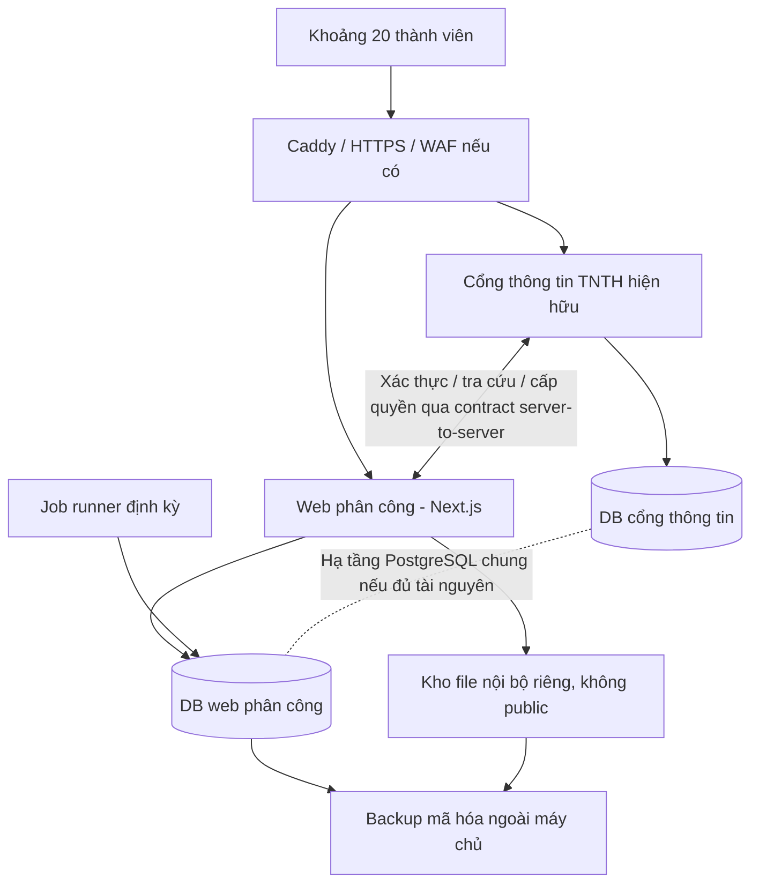
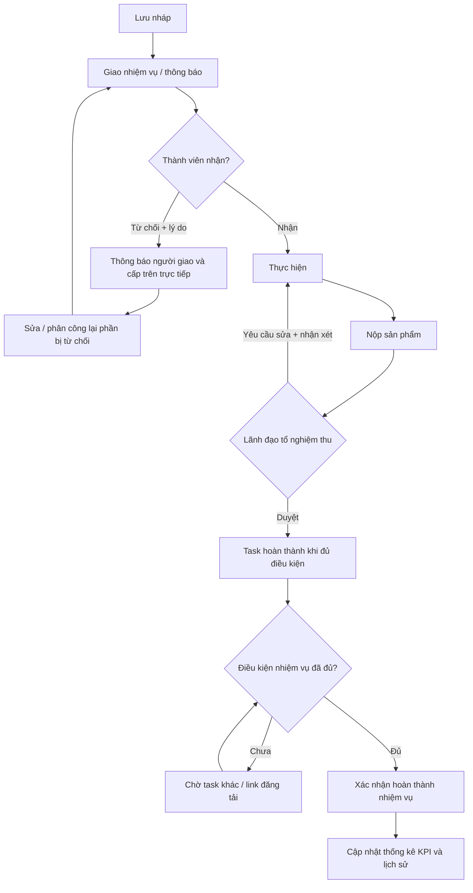

# WEB PHÂN CÔNG CÔNG VIỆC BAN BIÊN TẬP — THANH NIÊN TRƯỜNG HỌC

**Đặc tả nghiệp vụ, thiết kế kỹ thuật và chỉ dẫn triển khai cho AI Coding Agent**  
Phiên bản: 1.0 — baseline phát triển  
Ngôn ngữ sản phẩm: Tiếng Việt | Múi giờ: Asia/Ho_Chi_Minh  
Quy mô: khoảng 20 thành viên nội bộ | Mục tiêu: không phát sinh phí dịch vụ định kỳ nếu tận dụng được hạ tầng hiện hữu.

---

## 0. Chỉ dẫn bắt buộc cho AI Coding Agent

Bạn là kỹ sư full-stack chịu trách nhiệm xây dựng một website nội bộ hoàn chỉnh, hoạt động với dữ liệu thật, có thể kiểm thử và bàn giao. Đọc toàn bộ tài liệu này trước khi viết code. Đây là nguồn yêu cầu chính của dự án; không tự mở rộng phạm vi thành hệ thống ERP, CRM hay bản sao 1Office.

**Mục tiêu sản phẩm:** số hóa cách Ban Biên tập đang giao việc qua group chat, theo dõi bằng Excel và gửi sản phẩm bằng Drive/Canva. Gom thông tin về cùng một nơi, giúp giao việc nhanh, không trôi tin nhắn, biết ai đang làm gì, khi nào đến hạn, ai chưa nộp hoặc chưa duyệt. Người dùng không cần hiểu kỹ thuật để thao tác.

### 0.1. Cách thực hiện

1. Kiểm tra repository đang làm việc, git status, cấu trúc project và tài liệu này; không ghi đè phần công việc sẵn có.
2. Đọc repository tham chiếu của cổng thông tin (mục 3), tập trung vào xác thực, tài khoản, phân quyền, lưu file, database và deployment. Xác minh code mới nhất trước khi dùng lại; không giả định README luôn đúng.
3. Lập kế hoạch triển khai ngắn theo các giai đoạn ở mục 17; ghi rõ assumptions và blockers trong `docs/DECISIONS.md`. Nếu có thể thực hiện, tiếp tục viết code và kiểm thử, không chỉ trả lời bằng kế hoạch.
4. Xây dựng từng vertical slice có UI + API + database + authorization + tests. Ưu tiên luồng giao việc → nhận việc → nộp → duyệt → báo cáo chạy thật end-to-end.
5. Dùng dữ liệu giả lập chỉ trong development/test. Tách hoàn toàn dữ liệu demo với production. Không tạo các nút chỉ mang tính trang trí, thống kê hard-code hoặc giả vờ tích hợp đã thành công.
6. Không tự thuê server, mua dịch vụ, tạo tài khoản bên ngoài, thay DNS, truy cập hoặc deploy lên máy chủ thật, chạy migration trên database thật hay thay đổi cổng thông tin hiện tại nếu chưa được người có thẩm quyền cho phép.
7. Nếu thiếu quyền truy cập, credential hoặc API tích hợp, triển khai adapter có contract rõ ràng và mock trong test; đánh dấu phần production integration chưa hoàn tất. Không tự chế API nguồn, không bypass xác thực và không yêu cầu người dùng cung cấp mật khẩu/token trong chat hoặc commit chúng.
8. Chạy lint, typecheck, tests, production build và ghi kết quả thực tế. Báo cáo lỗi còn tồn tại, không tuyên bố đã hoàn thành nếu chưa kiểm chứng.
9. Giữ thiết kế đơn giản; không hỏi lại các quyết định đã có mặc định trong tài liệu. Chỉ dừng trước thao tác có rủi ro với hệ thống thật hoặc khi thiếu thông tin không thể suy ra an toàn.

### 0.2. Mức độ ưu tiên và nguồn yêu cầu

- **[GỐC]**: yêu cầu có trong tài liệu `Bảng mô tả web phân công.docx`, phải được giữ và kiểm thử.
- **[CHỐT]**: thông tin đã được người dùng xác nhận trong trao đổi (quy mô, định hướng, tận dụng hạ tầng).
- **[MẶC ĐỊNH]**: quy tắc bổ sung để xử lý trường hợp chưa rõ; dùng làm baseline, ghi nhận và cho phép thay đổi hợp lý. Không trình bày như quy chế đã được Ban thông qua.
- **P0**: bắt buộc trước khi nghiệm thu chính thức, bao gồm tích hợp tài khoản thật.
- **P1**: cải tiến không chặn MVP; chỉ làm khi P0 ổn định.
- Những phần cần xác nhận ở môi trường thật được đánh dấu **[CẦN XÁC MINH]**. Không biến các mục này thành yêu cầu phải hỏi người dùng trước khi phát triển local.

## 1. Phạm vi và nguyên tắc sản phẩm

### 1.1. Đã chốt

- Khoảng 20 người dùng, thiết kế đáp ứng 20 người đồng thời, dự phòng tăng lên 50–100 tài khoản mà không phải viết lại hệ thống.
- Dùng một tài khoản cho cổng thông tin và web phân công, nhưng quyền truy cập độc lập; chỉ người được cấp quyền mới vào web nội bộ.
- Có thể tận dụng server và tên miền của cổng thông tin Thanh niên Trường học; người phụ trách đã xác nhận có thể lưu dữ liệu local trên server và tham khảo cách triển khai từ source code hiện có.
- Website mới là công cụ quản lý công việc nội bộ, không phải nền tảng doanh nghiệp lớn. Tham khảo 1Office ở cách trình bày nhiệm vụ, tiến độ, báo cáo; không sao chép toàn bộ sản phẩm hoặc tài sản thương hiệu.
- Tối ưu sự tiện dụng: người dùng quen chat và Excel; giao việc nên ít thao tác, bảng nhiệm vụ dễ lọc, chi tiết tập trung thông tin và sản phẩm, có trao đổi theo công việc.
- Không mua thêm dịch vụ chỉ để làm dashboard, AI, gửi thông báo, xuất Excel, database hoặc lưu file nếu hạ tầng sẵn có đáp ứng được.

### 1.2. Phạm vi P0

Đăng nhập và cấp quyền; hồ sơ thành viên và tổ; khối nhiệm vụ; giao/nhận/từ chối/chuyển giao/hoãn/hủy/sửa nhiệm vụ; task và deadline; nộp link, file, folder; nghiệm thu và yêu cầu chỉnh sửa; kênh đăng tải; nhiệm vụ định kỳ; thông báo và nhắc hạn; dashboard tiến độ/điểm nghẽn; KPI; xuất Excel; quy chế và đồng xác nhận; quản trị kết nối cổng thông tin; bảo mật, sao lưu, kiểm thử và deployment.

### 1.3. P1 hoặc ngoài phạm vi

P1: Kanban đơn giản, lịch tháng, nhân bản nhiệm vụ/mẫu nhiệm vụ, lưu bộ lọc, import Excel cũ khi có mẫu, web push hoặc email quan trọng nếu đã có SMTP, xuất `.ics`. Bình luận theo từng nhiệm vụ là P0 (để thay group chat trong ngữ cảnh giao việc), không cần chat riêng.

Không triển khai: chat toàn hệ thống, call video, AI chấm KPI/giao việc, trình workflow kéo thả, tự động đăng mạng xã hội, chấm công, lương thưởng, Gantt phức tạp, native mobile app, multi-tenant, microservices, Kubernetes, Redis/Kafka, Firebase/Supabase/Vercel trả phí, SMS, Zalo API, tích hợp Canva/Drive API bắt buộc. Không dùng dữ liệu người dùng cho AI.

## 2. Trải nghiệm người dùng và bố cục

### 2.1. Điều hướng chính (7 mục)

| Mục | Nội dung |
|---|---|
| Tổng quan | Tổng số, đang làm, chưa bắt đầu, quá hạn, hoàn thành; việc cần xử lý, điểm nghẽn |
| Nhiệm vụ | Bảng công việc theo khối, tìm kiếm, lọc, tạo nhiệm vụ, xem chi tiết |
| Việc của tôi | Việc mới, đang làm, chờ duyệt, cần sửa, đã xong; nút nhận/từ chối/nộp |
| Thành viên | Danh bạ, hồ sơ, tổ chính/phụ, quản lý quyền theo thẩm quyền |
| KPI & báo cáo | Thống kê cá nhân/tổ/toàn Ban theo quyền, xuất Excel |
| Quy chế | Phiên bản hiện hành, lịch sử, yêu cầu sửa, hộp phê duyệt |
| Cài đặt | Hồ sơ cá nhân, cấu hình, khối nhiệm vụ, kênh, tích hợp, nhật ký theo quyền |

Header: logo/tên Ban, chuông thông báo với số chưa đọc, avatar. Sidebar thu gọn trên desktop; menu drawer hoặc thanh điều hướng phù hợp trên mobile. Chỉ hiển thị chức năng người dùng được quyền sử dụng; server vẫn kiểm tra mọi quyền.

### 2.2. Thiết kế giao diện

- Hiện đại, sạch, ưu tiên bảng dữ liệu giống Excel với header rõ ràng; nền trắng/xám nhạt, xanh dương chủ đạo (điều chỉnh theo bộ nhận diện nếu được cung cấp). Không tự lấy logo/ảnh có bản quyền từ 1Office.
- Mỗi hàng nhiệm vụ hiển thị tên, khối, tổ, phụ trách, deadline, độ khẩn, tiến độ, trạng thái và nút thao tác phù hợp. Nhóm theo khối; mặc định sắp xếp công việc chưa hoàn thành và sắp đến hạn trước trong từng khối. Có tùy chọn sort/filter.
- Form giao việc dạng một trang hoặc drawer rộng, không bắt buộc wizard nhiều bước. Chọn nhiều người bằng searchable multi-select, thêm task inline, tự gợi ý cấp khẩn từ deadline, lưu nháp và nút Giao nhiệm vụ nổi bật. Giao việc đơn giản có thể tạo một task mặc định cùng tên nhiệm vụ.
- Chi tiết nhiệm vụ: thông tin chung + danh sách task + sản phẩm + đăng tải + trao đổi + timeline lịch sử. Có nút nhận/từ chối, nộp, duyệt, trả sửa ngay trong ngữ cảnh. Link và sản phẩm các task liên quan có thể truy cập bởi người đang tham gia nhiệm vụ.
- Dashboard không cần quá nhiều biểu đồ. Ưu tiên số liệu, danh sách việc cần xử lý, lọc theo thời gian/tổ và click drill-down ra bảng danh sách tương ứng. Không hiển thị phần trăm giả định.
- Mobile từ 360 px: bảng có cuộn ngang hoặc card, nút bấm rõ, form không tràn. Có loading, empty, error, success, retry, cảnh báo chưa lưu, confirm hành động phá hủy. Keyboard navigation, label form, tương phản dễ đọc, không dùng màu làm tín hiệu duy nhất.
- Thời gian hiển thị `dd/MM/yyyy HH:mm` theo giờ Việt Nam; lưu UTC trong database; hiển thị cả ngày và giờ với nhiệm vụ gấp. Tên trạng thái tiếng Việt, mã enum chỉ dùng trong code.

### 2.3. Các màn hình/route đề xuất

| Route | Chức năng |
|---|---|
| `/login`, `/auth/callback` | Đăng nhập qua nguồn, callback nếu tích hợp cần |
| `/` | Dashboard theo quyền |
| `/missions`, `/missions/new`, `/missions/[id]` | Danh sách, tạo, chi tiết nhiệm vụ |
| `/my-work` | Công việc cá nhân |
| `/members`, `/members/[id]` | Danh bạ và hồ sơ |
| `/teams` | Quản lý tổ (có thể nằm dưới Thành viên) |
| `/reports`, `/reports/kpi`, `/reports/bottlenecks` | Báo cáo, KPI, điểm nghẽn |
| `/regulations`, `/approvals` | Quy chế và phê duyệt |
| `/notifications` | Danh sách thông báo |
| `/settings/profile`, `/settings/groups`, `/settings/channels`, `/settings/access` | Cấu hình theo quyền |
| `/settings/audit`, `/settings/integration` | Nhật ký, tích hợp |

Route có thể điều chỉnh theo App Router, nhưng không bỏ chức năng. Khi truy cập URL trực tiếp phải kiểm tra phiên và quyền server-side.

## 3. Hệ thống hiện hữu và kiến trúc được chọn

### 3.1. Repository tham chiếu (không phải repo để ghi đè)

- Website: https://thanhnientruonghoc.io.vn
- Repository: https://github.com/nguyenbaophuc27129-web/Website-Thanh-ni-n-Tr-ng-h-c.git
- Nhánh đã xem trong trao đổi: `main`.

Các file cần kiểm tra lại:

- [package.json](https://github.com/nguyenbaophuc27129-web/Website-Thanh-ni-n-Tr-ng-h-c/blob/main/package.json)
- [README.md](https://github.com/nguyenbaophuc27129-web/Website-Thanh-ni-n-Tr-ng-h-c/blob/main/README.md)
- [DEPLOY.md](https://github.com/nguyenbaophuc27129-web/Website-Thanh-ni-n-Tr-ng-h-c/blob/main/DEPLOY.md)
- [docker-compose.yml](https://github.com/nguyenbaophuc27129-web/Website-Thanh-ni-n-Tr-ng-h-c/blob/main/docker-compose.yml)
- [auth.ts](https://github.com/nguyenbaophuc27129-web/Website-Thanh-ni-n-Tr-ng-h-c/blob/main/src/lib/server/auth.ts), [login route](https://github.com/nguyenbaophuc27129-web/Website-Thanh-ni-n-Tr-ng-h-c/blob/main/src/app/api/auth/login/route.ts), `src/app/api/auth/session/route.ts`, `src/lib/auth-context.tsx`
- [accounts API](https://github.com/nguyenbaophuc27129-web/Website-Thanh-ni-n-Tr-ng-h-c/blob/main/src/app/api/accounts/route.ts), `src/app/api/accounts/[id]/permissions/route.ts`, [permissions.ts](https://github.com/nguyenbaophuc27129-web/Website-Thanh-ni-n-Tr-ng-h-c/blob/main/src/lib/permissions.ts), `src/lib/server/account-scope.ts`
- `src/lib/server/media.ts`, `src/app/api/uploads/route.ts`, `deploy/Caddyfile`, `deploy/db-backup.sh`, `db/migrations/`.

Các thông tin đã quan sát trong source: Next.js 16 (App Router), React 19, TypeScript, Tailwind, PostgreSQL 16 qua `pg`, xác thực bằng `accounts` và `auth_sessions`, băm mật khẩu scrypt, token ngẫu nhiên lưu hash và cookie `tnth_session`. Account ID dạng số trong source; quyền theo role, chức danh, phạm vi đơn vị và `account_permissions`. API tài khoản kiểm tra quyền/phạm vi; quyền riêng có thể **thay thế** tập quyền mặc định, không phải luôn cộng thêm. Triển khai Docker Compose trên Ubuntu, Caddy, tài liệu đề cập OneShield. File lưu ổ đĩa local, Caddy phục vụ `/uploads` trực tiếp. Backup tài liệu mô tả nằm cùng máy chủ. Có khác biệt giữa code và tài liệu cũ (ví dụ thuật toán hash, thời hạn session, fallback demo và lưu media); ưu tiên code đang chạy đã được xác minh.

**[CẦN XÁC MINH]**: cấu hình và mức sử dụng CPU/RAM/SSD thực tế; môi trường DB production đang sử dụng (tài liệu từng ghi `tnth_dev`, không được suy ra là hiện vẫn vậy); nhánh đang deploy; quyền thay đổi source; DNS/HTTPS/WAF subdomain; khả năng backup ra ngoài máy; API/session hiện tại có thể tích hợp theo cách nào. Không lưu IP server, SSH port, mật khẩu hay secret trong tài liệu dự án mới.

### 3.2. Kiến trúc chính thức đề xuất

Next.js full-stack **modular monolith**, một app riêng (repository riêng hoặc thư mục độc lập theo quyền của chủ repo), một database riêng trên cùng PostgreSQL server, một thư mục/volume riêng chứa file nội bộ. Caddy hiện hữu định tuyến thêm host; không chạy một Caddy khác chiếm cổng 80/443.



- Host dự kiến `work.thanhnientruonghoc.io.vn` (tên đề xuất, chưa xác nhận DNS). Có thể dùng tên khác mà không đổi kiến trúc.
- DB mới ví dụ `tnth_work`; DB role riêng, không có quyền đọc/ghi toàn bộ DB cổng thông tin. Không tạo bảng trùng tên vào DB nguồn; không truy vấn join xuyên DB trực tiếp. Các liên kết định danh dùng `external_account_id`.
- Không dùng API snapshot toàn bộ store làm cơ chế ghi dữ liệu nhiệm vụ. Dùng CRUD/action theo thực thể, transaction, cập nhật có version. Đây là app mới, không phải bản copy cơ chế sync cũ.
- Không phụ thuộc cổng thông tin để render mọi trang; liên kết nguồn chỉ ở các luồng cần định danh/quyền nguồn, cache giới hạn hợp lý và kiểm tra thu hồi quyền.
- Một máy chủ hiện hữu không đồng nghĩa với miễn phí vô hạn hoặc HA: tài nguyên chung có nguy cơ ảnh hưởng hai web; phải đo tải, dùng giới hạn tài nguyên, backup và rollback.

### 3.3. Stack

| Hạng mục | Chọn |
|---|---|
| Runtime | Node.js LTS tương thích với Next.js, pin version |
| Full-stack | Next.js App Router + React + TypeScript strict |
| UI | Tailwind CSS + shadcn/ui khi hữu ích, Lucide icons |
| Form/validation | Zod, React Hook Form nếu phù hợp |
| Database | PostgreSQL 16 hoặc bản đang được quản trị hỗ trợ |
| Driver/migration | `pg` + SQL migrations có version, parameterized query |
| Data fetching | Server Components cho trang đọc; TanStack Query hoặc fetch polling cho màn hình động, chọn một cách nhất quán |
| Biểu đồ/Excel | Recharts (chỉ biểu đồ cần thiết), ExcelJS |
| Xác thực | Adapter hệ thống nguồn, session riêng bằng opaque token và cookie an toàn |
| Jobs | Cron hoặc process nhỏ gọi job runner; lưu lịch/trạng thái trong PostgreSQL, không cần Redis |
| Storage | Private local filesystem với adapter có thể thay đổi sau |
| Tests | Vitest, PostgreSQL integration tests, Playwright |
| Deploy | Docker Compose, Caddy hiện hữu, Linux, backup bằng pg_dump + Restic hoặc công cụ tương đương |

Không cần ORM riêng vì source hiện tại dùng `pg`; nếu repo mới đã có ORM ổn định, ghi quyết định và giữ nguyên nếu không làm tăng độ phức tạp. Không cài đồng thời nhiều ORM. Kiểm tra license và lockfile; không chọn phiên bản tùy tiện.

## 4. Tài khoản, tích hợp và bảo mật phiên

### 4.1. Yêu cầu bắt buộc [GỐC]

Một tài khoản đăng ký ở `thanhnientruonghoc.io.vn` dùng được cho hai nền tảng; không tạo mật khẩu thứ hai cho người dùng thật. Web phân công chỉ mở cho tài khoản được chỉ định cấp quyền. Người có thẩm quyền tra cứu tài khoản nguồn để thêm thành viên. Có thể phân công thành viên quản trị cổng thông tin từ web mới; quyền thực tế phải đi qua cơ chế nguồn được ủy quyền.

### 4.2. Phương án tích hợp (ưu tiên đăng nhập tiện nhất)

**A — Ưu tiên:** dùng SSO nếu có OIDC hoặc triển khai cơ chế cấp authorization code một lần tại cổng thông tin với sự đồng ý của quản trị viên. Web phân công redirect đến trang xác thực nguồn; nguồn kiểm tra session hiện tại (đã đăng nhập thì không phải nhập lại mật khẩu), trả code ngắn hạn một lần; backend web mới đổi code qua kênh server-to-server lấy định danh tài khoản. Web mới kiểm tra whitelist và tạo session riêng.

- Dùng thư viện chuẩn OIDC nếu có; nếu nguồn chưa có, bridge phải được review, không tự nhận là OIDC. Code random đủ entropy, chỉ lưu hash, hạn tối đa 60 giây, dùng một lần qua transaction, ràng buộc client/redirect URI/state và PKCE khi phù hợp; exact allowlist redirect URI; TLS, client authentication cho backchannel. Không truyền mật khẩu, session token nguồn hoặc dữ liệu cá nhân qua query string. Không lưu token trong localStorage.
- Cookie riêng ví dụ `tnth_work_session`, host-only, HttpOnly, Secure ở production, SameSite=Lax; không mở domain cookie `.thanhnientruonghoc.io.vn` để các subdomain khác dùng chung cookie. Session ID opaque random 32 bytes trở lên, DB lưu hash, hết hạn tuyệt đối mặc định 7 ngày, revoke được. Không cần JWT lưu ở trình duyệt.
- Xác thực nguồn và kiểm tra quyền nội bộ là hai bước độc lập. Trạng thái khóa/vô hiệu hóa từ nguồn phải được tôn trọng theo contract thật; không kế thừa hành vi tự mở khóa từ logic cũ.

**B — Fallback nếu không thể SSO ngay:** vẫn dùng một tài khoản, thông qua endpoint xác thực chính thức của nguồn được quản trị viên cho phép và giao tiếp server-to-server an toàn; người dùng có thể phải đăng nhập lại ở web mới, nhưng không lưu password nguồn trong DB mới. Không gọi API công khai bằng session của một admin chung, không scrape, không sao chép bảng password hash, không cấp credential DB nguồn cho app mới.

Nếu chưa có API được ủy quyền: chỉ chạy development/test với adapter giả lập, không cho dùng demo trên production. Không công bố đã hoàn thành “01 tài khoản – 02 nền tảng” trước khi integration test với nguồn thực tế thành công.

### 4.3. Contract adapter (tên hàm nội bộ, không khẳng định API nguồn đã tồn tại)

```ts
interface PortalIdentity {
  provider: 'tnth';
  externalAccountId: string;
  username: string;
  displayName: string;
  email?: string;
  status: 'ACTIVE' | 'PENDING' | 'DISABLED' | 'LOCKED' | 'UNKNOWN';
}
interface PortalIdentityProvider {
  exchangeCode(code: string, verifier: string): Promise<PortalIdentity>;
  getAccountStatus(externalAccountId: string): Promise<PortalIdentity>;
  searchAccounts(query: string, cursor?: string): Promise<{items: PortalIdentity[]; nextCursor?: string}>;
  // optional, only when officially authorized:
  requestPortalPermissionChange?(request: PortalPermissionRequest): Promise<PortalPermissionResult>;
}
```

Schema chính xác của payload/error, URL API, credential và cách auth cần thống nhất với quản trị viên nguồn. Adapter có timeout, rate limit, logging không chứa token; retry chỉ với thao tác an toàn/idempotent. Không tạo quyền nguồn tự động chỉ vì quyền nội bộ thay đổi. Tra cứu theo ID/username/email, trả dữ liệu tối thiểu, phân trang, audit và không expose toàn bộ danh sách ra client không có quyền.

### 4.4. Cấp và thu hồi quyền nội bộ

Bậc 01.01 tra cứu tài khoản nguồn đã active, chọn người, cấp Bậc 01.02/02/03/04 và tổ tương ứng. Tạo hồ sơ nội bộ với external ID duy nhất, không copy password. Một người có một hồ sơ. Nếu tài khoản chưa được cấp quyền, trả màn hình “Bạn chưa được cấp quyền truy cập” và không lộ dữ liệu. Bậc 02 có quyền thực hiện nâng 01.02 theo phê duyệt và thu hồi 03/04; Bậc 03 thu hồi 04 trong phạm vi tổ; các quyền khác xem mục 5.

Thu hồi quyền nội bộ/đổi chức vụ có hiệu lực ở request tiếp theo (server đọc membership hiện hành; revoke session nếu cần). Trạng thái nguồn được kiểm tra ở lúc đăng nhập và tái kiểm tra tối đa mỗi 5 phút trong phiên hoạt động; thao tác quản trị nhạy cảm luôn yêu cầu kiểm tra nguồn mới. Nếu nguồn mất kết nối: không đăng nhập mới/không cấp quyền mới; phiên đã xác minh có thể xem dữ liệu được phép trong tối đa 5 phút kể từ lần kiểm tra thành công, sau đó fail closed cho đến khi nguồn phục hồi. Không dùng localStorage demo làm fallback. Logout web mới thu hồi session riêng; logout toàn hệ thống nếu nguồn hỗ trợ, không giả định bắt buộc.

### 4.5. Phân công quản trị website nguồn

Tách `nhiệm vụ quản trị cổng thông tin` khỏi `quyền truy cập kỹ thuật thật`. Có thể tạo task cho người được chỉ định như các nhiệm vụ khác. Đối với quyền thật: Bậc 01.01 (hoặc Bậc 02 được ủy quyền rõ ràng) tạo yêu cầu với tài khoản, quyền cụ thể, lý do, thời hạn. Chỉ thực thi qua API nguồn có service credential hạn chế hoặc quản trị viên nguồn xác nhận thủ công; lưu trạng thái PENDING/APPLIED/REJECTED/FAILED/REVOKED, người xác nhận và bằng chứng. Không thay toàn bộ `account_permissions` bằng danh sách mới một cách mù quáng vì source có cơ chế override quyền. Xem lại quyền hiện có và kiểm tra thẩm quyền nguồn trước khi thay đổi. Không gắn nhãn đã cấp quyền nếu chỉ tạo yêu cầu. P0 tích hợp này cần kiểm thử với quản trị viên nguồn; nếu không có API, quy trình thủ công có xác nhận là fallback được ghi rõ và cần chủ nghiệp vụ chấp nhận.

## 5. Cơ cấu tổ chức và phân quyền

### 5.1. Cấp bậc và tổ [GỐC]

| Mã nội bộ | Hiển thị |
|---|---|
| `HEAD` | Bậc 01.01 — Trưởng Ban Biên tập |
| `ACTING_HEAD` | Bậc 01.02 — Quyền Trưởng Ban Biên tập |
| `DEPUTY` | Bậc 02 — Phó Trưởng Ban Biên tập |
| `TEAM_LEAD` | Bậc 03 — Trưởng, Phó Tổ chuyên môn |
| `MEMBER` | Bậc 04 — Mem |

Seed danh mục 7 tổ, không hard-code trong logic: Tổ Xây dựng Nội dung; Tổ Phóng viên – Công tác cơ sở; Tổ Media; Tổ Kỹ thuật; Tổ Công tác 35; Tổ VietGENIUS; Tổ Thẩm tra – Giám sát. Một người có một tổ chính và nhiều tổ phụ. Lãnh đạo tổ có phạm vi theo membership; lưu chức danh trưởng/phó tổ để hiển thị, mặc định hai chức danh có quyền giống nhau trong tổ.

[MẶC ĐỊNH] Một cấp bậc chính hiệu lực cho mỗi người, có thể giữ vai trò trưởng/phó ở nhiều tổ thông qua membership; quyền lãnh đạo tổ độc lập không được dùng để tự nâng cấp quyền toàn Ban. Tối đa một HEAD và một ACTING_HEAD đang hiệu lực; ACTING_HEAD có thể tồn tại khi HEAD vắng mặt/ủy quyền, không có quyền tự thay thế HEAD. Nâng cấp thành HEAD chỉ khi không còn HEAD hiệu lực, hoặc quy trình chuyển giao có người có thẩm quyền xác nhận đồng thời. Có lịch sử thay đổi chức vụ. Không dùng thứ tự số của bậc để suy ra mọi quyền.

### 5.2. Ma trận quyền

`Toàn Ban` là phạm vi toàn bộ nghiệp vụ; `tổ` là tổ mình lãnh đạo; `liên quan` là nhiệm vụ có phân công, phụ trách, được theo dõi hoặc cần nghiệm thu; `self` là bản thân. Dấu `—` là không có quyền mặc định. Các giới hạn là mặc định thận trọng khi tài liệu chưa nói rõ.

| Hành động | 01.01 | 01.02 | 02 | 03 | 04 |
|---|---|---|---|---|---|
| Xem danh bạ cơ bản | Toàn Ban | Toàn Ban | Toàn Ban | Toàn Ban | Toàn Ban (tối thiểu) |
| Xem hồ sơ chi tiết | Toàn Ban | Toàn Ban (read-only) | Toàn Ban | tổ | self |
| Sửa hồ sơ người khác | cấp dưới | — | 03/04 | 04 trong tổ | — |
| Sửa hồ sơ bản thân (không role/status) | Có | Có | Có | Có | Có |
| Cấp quyền truy cập/gán cấp bậc | 01.02/02/03/04 | — | nâng 01.02 theo phê duyệt | — | — |
| Thu hồi/xóa tên thành viên | 02/03/04 | — | 03/04 | 04 trong tổ | — |
| Quản lý tổ và khối nhiệm vụ | Có | — | Có | — | — |
| Tạo/giao nhiệm vụ | Toàn Ban, self | cấp dưới, self | cấp dưới, self | tổ, self, 01/02 | — |
| Sửa/hủy/hoãn/chuyển giao | Toàn Ban | Toàn Ban trong thẩm quyền giao | Toàn Ban trong thẩm quyền giao | nhiệm vụ mình quản lý/tổ | — |
| Xem nhiệm vụ | Toàn Ban | Toàn Ban | Toàn Ban | tổ + liên quan | liên quan |
| Nhận/từ chối/nộp | được giao | được giao | được giao | được giao | được giao |
| Nghiệm thu task | theo quy tắc 5.3 | theo quy tắc 5.3 | theo quy tắc 5.3 | lãnh đạo tổ phụ trách | — |
| Chốt nhiệm vụ/cập nhật đăng tải | theo nhiệm vụ | theo nhiệm vụ | theo nhiệm vụ | theo nhiệm vụ | chỉ cập nhật nếu được giao task đăng tải, không tự chốt |
| Xem KPI cá nhân | self | self | self | self | self |
| Xem KPI người khác/xuất báo cáo | Toàn Ban | Toàn Ban | Toàn Ban | tổ | — (xuất cá nhân nếu cần) |
| Xem quy chế đã ban hành | Có | Có | Có | Có | Có |
| Đề xuất sửa quy chế | Có | Có | Có | — | — |
| Đồng xác nhận sửa quy chế | cho 02 | — | cho 01.01/01.02 | cho 01.02 | — |
| Đề xuất nâng 01.02 → 01.01 | — | — | Có | — | — |
| Đồng xác nhận nâng cấp | — | — | đề xuất/thực hiện | tất cả tài khoản 03 | — |
| Quản trị quyền cổng thông tin | tạo yêu cầu | — | nếu được ủy quyền | — | — |
| Audit/cấu hình | Toàn Ban | xem nghiệp vụ phù hợp | Toàn Ban theo quyền | tổ (nghiệp vụ) | lịch sử việc của mình |

Giải thích: Bậc 03 có ngoại lệ giao việc cho 01/02 theo tài liệu gốc, nhưng không được vì vậy chỉnh quyền của cấp trên hay xem toàn bộ công việc/hồ sơ của họ. Bậc 03 chỉ được giao vào tổ mình quản lý; với nhiệm vụ liên tổ, 01/02 điều phối. Người tạo có thể quản lý nhiệm vụ của mình trong phạm vi cấp bậc, không được sửa mọi nhiệm vụ do cấp trên/đơn vị khác tạo. Bậc 01.02 không tự thêm/bỏ khối, không sửa danh sách thành viên người khác. Chưa có quyền mặc định thu hồi Bậc 01.02 qua UI theo tài liệu; xử lý kết thúc ủy quyền bằng quy trình có audit và chủ sở hữu nghiệp vụ, không tự cấp thêm quyền xóa.

### 5.3. Nghiệm thu, xung đột lợi ích và quản trị kỹ thuật

- Task thuộc một tổ phụ trách chính; lãnh đạo tổ đó nghiệm thu. Chọn reviewer chính khi giao; một trong các lãnh đạo đủ quyền của tổ có thể duyệt nếu không chỉ định độc quyền. Người phối hợp không tự trở thành reviewer.
- 01.01/01.02/02 được xác nhận nhiệm vụ theo phạm vi; với task, lãnh đạo tổ là reviewer mặc định theo nguồn gốc. Cấp quản trị có thẩm quyền chỉ thay reviewer/duyệt thay khi reviewer không có, vắng hoặc xung đột lợi ích, phải ghi lý do và audit. Không ghi đè kết quả âm thầm.
- Người nộp sản phẩm không tự nghiệm thu sản phẩm của mình; kể cả lãnh đạo tự giao việc cho bản thân, chọn reviewer khác có quyền. Nếu không có reviewer phù hợp, trạng thái cần phân công reviewer, thông báo HEAD/DEPUTY; không tự hoàn thành. Cho phép cơ chế ngoại lệ có phê duyệt bởi người khác, không bypass quyền.
- Một quyền kỹ thuật `OPS`/operator (không phải cấp bậc Ban Biên tập) chỉ phục vụ triển khai, backup, restore, kiểm tra health. Không mặc nhiên có quyền nghiệp vụ. Bootstrap tài khoản HEAD bằng script chạy một lần, dựa trên ID nguồn đã xác minh, audit và vô hiệu hóa bootstrap sau khi xong. Không seed tài khoản admin thật với mật khẩu mặc định.
- Triển khai tập hàm policy tập trung: `can(actor, action, resource)`, `requirePermission`, `scopeQuery`. Mọi API đọc/ghi, download, dashboard, Excel đều kiểm tra object-level authorization; không chỉ ẩn nút trên UI. Quyền theo role + tổ + người liên quan + trạng thái. Khi không xác định được quyền thì từ chối mặc định.

## 6. Thành viên, tổ và khối nhiệm vụ

### 6.1. Hồ sơ thành viên [GỐC]

Các trường bắt buộc trong tài liệu: họ tên, ảnh cá nhân rõ mặt (không bắt buộc phông nền chuẩn), ngày sinh, nơi sinh, quê quán, liên hệ (email, SĐT, mạng xã hội), đơn vị học tập/công tác hiện tại, quá trình học tập, thành tích học tập/nghiên cứu khoa học, thành tích công tác Đoàn và phong trào thanh thiếu nhi, ngày bắt đầu công tác tại Ban, tình trạng hoạt động.

Bổ sung mã thành viên, ID nguồn, cấp bậc, tổ chính/phụ, chức vụ tại tổ, ngày cập nhật. Khi mới được cấp quyền, có thể ở trạng thái hồ sơ chưa hoàn thiện và nhắc tự bổ sung; trường thành tích cho phép khai “Chưa có”, mạng xã hội tùy nền tảng/không có thì ghi rõ, không bắt điền dữ liệu giả. Kiểm tra ngày sinh/ngày tham gia hợp lệ, email/URL, file ảnh theo chính sách. Không thu thập thêm CCCD, vị trí GPS hoặc sinh trắc học.

Ba tình trạng hoạt động: `ACTIVE` (Đang hoạt động), `ON_LEAVE` (Tạm dừng vì lý do cá nhân), `INACTIVE` (Đã dừng). Tách `access_enabled` khỏi tình trạng hoạt động. Thành viên tạm nghỉ mặc định không xuất hiện trong danh sách giao việc mới nhưng có thể xem lịch sử nếu còn quyền. Thành viên nghỉ hẳn mặc định revoke access. Khi ngừng hoạt động, hiển thị các assignment/review đang mở để chuyển giao, không xóa lịch sử hoặc mất task. Cấp 04 không tự sửa trạng thái, tổ, chức vụ hoặc quyền. Thành viên có thể tự sửa thông tin cá nhân, trừ trường nguồn chỉ đọc được quản trị ở cổng thông tin; hiển thị rõ trường nào lấy từ nguồn.

Danh bạ cơ bản: họ tên, avatar, tổ, chức vụ, trạng thái; hạn chế số điện thoại, email, ngày sinh, nơi sinh, quê quán, học tập/thành tích cho người được phép. Không dùng ảnh đại diện URL public của app mới nếu hồ sơ là nội bộ.

### 6.2. Tổ và khối

HEAD/DEPUTY quản trị danh mục tổ và khối nhiệm vụ (tạo, đổi tên, ngừng dùng, thứ tự). Một membership đang hiệu lực có `is_primary`; constraint không có hai tổ chính; khi đổi tổ chính phải thực hiện transaction. Trưởng/phó tổ được gán qua người có quyền. Khi ngừng tổ/khối, không xóa nếu có dữ liệu lịch sử; không cho giao việc mới vào danh mục ngừng hoạt động. Khối là nhóm nhiệm vụ theo chủ đề, chiến dịch hoặc công việc định kỳ; khi xuất Excel, các nhiệm vụ cùng khối phải liên tiếp.

## 7. Nhiệm vụ và task — mô hình nghiệp vụ cốt lõi

### 7.1. Phân cấp

`Khối nhiệm vụ → Nhiệm vụ (mission) → Task → Phân công cá nhân (assignment) → Sản phẩm/phiên bản nộp → Nghiệm thu`.

Ví dụ khối “Truyền thông tháng 11” có nhiệm vụ “Bài truyền thông sự kiện”, task viết nội dung / thiết kế / kiểm duyệt / đăng tải. Task có tổ phụ trách chính, có thể nhiều người phụ trách và nhiều người thực hiện. Không bắt buộc nhiệm vụ có nhiều task: form đơn giản tự tạo 1 task mặc định khi giao việc trực tiếp. Không tạo thêm cấp subtask lồng vô hạn.

### 7.2. Dữ liệu nhiệm vụ

| Trường | Quy tắc |
|---|---|
| Mã | Hệ thống tạo, duy nhất, ổn định; ví dụ `NV-2026-0001` |
| Tên, khối | Bắt buộc khi giao |
| Mô tả/yêu cầu/kết quả mong đợi | Bắt buộc khi giao, hỗ trợ văn bản + link |
| Ref | Một hoặc nhiều URL tham khảo, có thể không có |
| Người tạo, người phụ trách chung | Người tạo tự ghi, một người chủ trì bắt buộc |
| Tổ tham gia | Một hoặc nhiều tổ |
| Thường vụ phụ trách và người thực hiện | Multi-select từ tài khoản phù hợp, phân bổ theo task |
| Thời điểm bắt đầu, deadline | Deadline bắt buộc; ngày/giờ/phút, cho nhập giờ tương đối rồi chuyển sang timestamp tuyệt đối |
| Mức khẩn | Hỏa tốc, Thượng khẩn, Khẩn, Thông thường |
| Mức quan trọng | Trọng tâm hoặc Thông thường |
| Danh sách task | Tối thiểu một task khi giao, có thể thêm/sắp xếp |
| Điều kiện hoàn thành | Xem 7.6 |
| Kênh đăng tải | Chọn các kênh cần có link, nếu áp dụng |
| File/link đính kèm | Tùy chọn, private file access |
| Định kỳ | Tùy chọn, liên kết template lịch lặp |
| Trạng thái/version/thời điểm | Tự quản lý, không sửa trực tiếp qua form |

### 7.3. Dữ liệu task và assignment

Task: mã, mission ID, tên, mô tả, tiêu chí sản phẩm, thứ tự, tổ chịu trách nhiệm chính, tổ phối hợp nếu cần, các thường vụ phụ trách (multi-select), một người đầu mối chính, reviewer chính nếu chỉ định, deadline, mức khẩn kế thừa hoặc riêng, mức quan trọng kế thừa, trọng số khối lượng, danh sách người thực hiện, chế độ nộp (`INDIVIDUAL` hoặc `SHARED`), mốc hoàn thành, trạng thái, version. Có thể chọn task tiền nhiệm trong cùng nhiệm vụ (tùy chọn, không bắt buộc). Kiểm tra không tạo chu trình.

Assignment: task ID, member ID, vai trò thực hiện/chủ trì, người giao, thời điểm giao, deadline hiệu lực (mặc định task deadline), trạng thái nhận việc, lý do từ chối, trạng thái thực hiện, thời điểm nộp hợp lệ, thời điểm duyệt, trọng số cá nhân, dữ liệu chuyển giao. Một tài khoản chỉ có một assignment hiệu lực trên cùng task. Lịch sử lần giao cũ không bị xóa. “Người phụ trách/theo dõi” không mặc nhiên được tính KPI nếu không có assignment thực hiện.

Mặc định task nộp cá nhân nếu có nhiều đầu ra riêng; nộp chung nếu sản phẩm là một đầu ra tập thể. Người giao chọn rõ trên form; với 1 người thì không cần hiện lựa chọn. Nộp chung: một đại diện được chỉ định nộp cho nhóm đã nhận việc, review xác nhận danh sách người đóng góp; không tự cho điểm người chưa nhận hoặc đã từ chối. Trọng số cá nhân chia đều mặc định, cho phép điều chỉnh khi giao. Mỗi task có đầu ra yêu cầu rõ và một tổ nghiệm thu.

### 7.4. Mức độ khẩn cấp và hạn

Giữ phân loại gốc, chuẩn hóa ranh giới: Hỏa tốc ≤ 3 giờ (nguồn ghi 1–3, cho phép dưới 1 giờ để xử lý việc gấp); Thượng khẩn >3 đến 12 giờ; Khẩn >12 đến 48 giờ; Thông thường >48 giờ. Tính theo khoảng từ lúc giao/được lên lịch giao đến deadline; tự gợi ý, người giao có thể đổi và ghi lý do. Trọng tâm/Thông thường là phân loại nội dung riêng, không tự suy ra từ độ khẩn.

Hỗ trợ deadline riêng cho từng task và assignment khi thực sự cần. Task deadline mặc định không vượt deadline nhiệm vụ; nếu cần gia hạn, cập nhật deadline nhiệm vụ phù hợp hoặc ghi ngoại lệ có thẩm quyền. Mốc thời gian mới phải nằm sau thời điểm giao khi giao lần đầu; khi nhập dữ liệu lịch sử phải có quyền và audit. Lưu deadline gốc, hiện tại, thời điểm sửa, người sửa, lý do. Không chỉnh lùi timestamp nộp/duyệt bằng UI. Mọi thay đổi deadline sau giao thông báo người liên quan.

### 7.5. Workflow và trạng thái

Mission status: `DRAFT`, `ASSIGNED`, `IN_PROGRESS`, `AWAITING_REVIEW` (toàn bộ task cần thiết đã nộp/đang chờ), `AWAITING_PUBLICATION` (điều kiện task đã đạt nhưng còn đăng tải), `COMPLETED`, `ON_HOLD`, `CANCELLED`. Task status: `DRAFT`, `ASSIGNED`, `IN_PROGRESS`, `SUBMITTED`, `REVISION_REQUIRED`, `COMPLETED`, `ON_HOLD`, `CANCELLED`. Assignment status: `PENDING`, `ACCEPTED`, `DECLINED`, `SUBMITTED`, `REVISION_REQUIRED`, `COMPLETED`, `TRANSFERRED`, `CANCELLED`. Hoãn có thể dùng trạng thái trên task/mission và giữ trạng thái trước hoãn để khôi phục. Quá hạn là cờ tính động, không thay thế trạng thái nghiệp vụ; `BLOCKED` là lý do/cờ phụ thuộc, không làm mất trạng thái gốc.



| Action | Điều kiện và hậu quả |
|---|---|
| Save draft | Người có quyền tạo; dữ liệu có thể chưa đủ; không thông báo, không tính KPI |
| Assign | Validate dữ liệu, người/tổ active và quyền; tạo assignment PENDING, log và notification trong transaction |
| Accept | Chỉ người được giao; chuyển ACCEPTED, ghi thời điểm; task/mission cập nhật |
| Decline | Chỉ PENDING; lý do bắt buộc; thông báo người giao và quản lý trực tiếp; phần assignment cần phân công lại, không reset người khác |
| Submit | Người đã nhận việc, task cho nộp; validate đầu ra; thêm version; thông báo reviewer |
| Request revision | Reviewer có quyền, nhận xét bắt buộc; giữ bản cũ; cho nộp lại; không tự gia hạn deadline |
| Review/approve | Reviewer không phải người nộp; duyệt phiên bản cụ thể; cập nhật assignment/task khi đủ điều kiện |
| Edit | Có quyền và version đúng; thay đổi người/deadline/đầu ra quan trọng có log và thông báo; nếu phạm vi thay đổi đáng kể, yêu cầu người liên quan xác nhận lại |
| Transfer | Giữ bản ghi người cũ + sản phẩm; tạo assignment mới PENDING cho người thay thế; ghi lý do, phân bổ khối lượng còn lại |
| Hold/Resume | Có lý do và thời điểm dự kiến tiếp tục; lưu trạng thái cũ; không tự đổi deadline; tạm dừng nhắc hạn thông thường, hiển thị việc hoãn quá ngày dự kiến |
| Cancel | Lý do bắt buộc; hủy phần mở, giữ lịch sử, dừng nhắc; phần đã hoàn thành giữ dữ liệu và KPI theo quy tắc mục 10 |
| Reopen | Người có thẩm quyền chốt; lý do, target task/assignment cụ thể, audit; không xóa nghiệm thu cũ, chỉ tạo vòng xử lý mới; KPI kỳ đã chốt không đổi âm thầm |

Với nhiều assignment: task được coi là đang thực hiện khi ít nhất một người đã nhận; assignment còn chờ/từ chối hiển thị riêng. Task hoàn thành khi các assignment bắt buộc và sản phẩm tương ứng đã nghiệm thu (nộp chung theo nhóm được xác nhận). Assignment đã hủy/chuyển giao hợp lệ không chặn hoàn thành, nhưng phần khối lượng chưa phân công lại phải được xử lý hoặc miễn trừ có lý do. Không cho chốt task khi không có đầu ra, trừ task được khai rõ không có sản phẩm file/link (nộp xác nhận văn bản/checklist vẫn cần reviewer). Mission tiến độ = số task bắt buộc đã hoàn thành / số task bắt buộc hợp lệ, hiển thị cả tử/mẫu; không dùng slider % giả. Nếu chưa có task hợp lệ hiển thị chưa có dữ liệu, không coi 100%.

### 7.6. Điều kiện hoàn thành nhiệm vụ — giữ yêu cầu “hoặc” của nguồn

Tài liệu gốc cho phép hoàn thành sau khi tất cả task được lãnh đạo tổ xác nhận **hoặc** sau khi cập nhật tất cả kênh/nền tảng đăng tải. Không tự biến mọi nhiệm vụ thành bắt buộc cả hai. Mặc định bổ sung trường `completion_mode` rõ ràng để tránh hiểu sai:

- `TASKS_ONLY`: nhiệm vụ nội bộ, tất cả task bắt buộc đã nghiệm thu. Mặc định khi không yêu cầu đăng tải.
- `TASKS_AND_PUBLICATIONS`: nhiệm vụ truyền thông cần kiểm duyệt và đăng tải, tất cả task bắt buộc đã nghiệm thu **và** đủ link kênh bắt buộc. Mặc định khi chọn kênh đăng tải (an toàn nghiệp vụ hơn, là đề xuất bổ sung).
- `PUBLICATIONS_ONLY`: hoàn thành theo link đăng tải như nhánh “hoặc” nguồn, chỉ HEAD/DEPUTY (hoặc ACTING_HEAD trong ủy quyền) chọn rõ khi giao và ghi lý do. Có ít nhất một kênh bắt buộc, tất cả có link hợp lệ; task chưa nghiệm thu vẫn giữ trạng thái riêng, không tự cấp KPI hoàn thành cho task đó. UI cảnh báo khi chọn mode này.

Khi đủ điều kiện, hiển thị nút “Xác nhận hoàn thành nhiệm vụ” cho người phụ trách quản trị có thẩm quyền; ghi người/thời điểm xác nhận. Không auto-chốt âm thầm; nếu chưa bấm, đưa vào hàng chờ xác nhận. Tất cả trạng thái tổng hợp được tính nhất quán tại backend. Việc đổi mode sau giao là thao tác nhạy cảm, cần lý do và audit, không sửa nhằm hợp thức hóa kết quả.

### 7.7. Nhiệm vụ định kỳ

Hỗ trợ lặp tuần/tháng/năm [GỐC], thêm ngày nếu cần. Template gồm tên, khối, cấu trúc task, người mặc định, mức khẩn/quan trọng, lịch bắt đầu/kết thúc, deadline offset và chế độ tạo nháp hoặc giao tự động. Mặc định tạo nháp trước để quản lý kiểm tra; nếu bật giao tự động, kiểm tra lại thành viên active/quyền tại mỗi lần tạo, lỗi đưa vào hàng chờ. Unique `(schedule_id, occurrence_at)` chống trùng khi restart; lưu timezone; ngày 29–31 của tháng ngắn hơn dùng ngày cuối tháng (UI giải thích), năm nhuận tương tự. Nếu downtime, catch-up có giới hạn và đánh dấu các kỳ bị bỏ lỡ để quản trị xử lý, không gửi hàng loạt công việc cũ vô hạn. Sửa lịch chỉ ảnh hưởng kỳ tương lai. Mỗi lần lặp là nhiệm vụ riêng, không ghi đè nhiệm vụ cũ.

## 8. Sản phẩm, trao đổi và kênh đăng tải

### 8.1. Nộp sản phẩm [GỐC]

Hỗ trợ cả link, file và folder, không yêu cầu cài thêm công cụ hoặc đăng nhập bên thứ ba chỉ để dùng website. Trang nộp hiển thị tên nhiệm vụ, khối, task của mình, deadline, yêu cầu đầu ra và danh sách sản phẩm của các task khác trong cùng nhiệm vụ mà người dùng được phép xem.

- Link: Google Drive, Canva, OneDrive hoặc URL HTTPS/HTTP hợp lệ; lưu nhãn, URL, người nộp, thời điểm, ghi chú. Không tự tải nội dung từ URL do user cung cấp (tránh SSRF), không tự xác nhận link còn quyền truy cập. Hiển thị nhắc người nộp chia sẻ quyền đúng người nhận. Không nhúng iframe không tin cậy.
- File: hỗ trợ PNG/JPG/JPEG/WebP, PDF, DOC/DOCX, XLS/XLSX, PPT/PPTX, MP4/MOV, ZIP và định dạng an toàn khác được cấu hình. Tài liệu ghi `mv4`, mặc định hiểu là video MP4; nếu thực tế dùng M4V thì thêm allowlist sau khi kiểm tra MIME. Video lớn ưu tiên link.
- Folder: link thư mục hoặc upload nhiều file/ZIP. Nếu hỗ trợ browser directory picker, giữ cấu trúc đường dẫn tương đối đã sanitize, giới hạn số file, không tự giải nén ZIP trên server. Trên mobile luôn có phương án nộp link/ZIP thay cho directory picker.
- Cho phép nộp nội dung văn bản/checklist khi task không có file. Một lần nộp có nhiều link/file; có thể lưu nháp riêng trước khi gửi. Không tính bản nháp là đã nộp.

### 8.2. Phiên bản và nghiệm thu

Mỗi lần nộp chính thức tạo version bất biến, lưu nội dung, người nộp, thời gian, assignment liên quan và danh sách file/link. Reviewer duyệt đúng version, có nhận xét; nếu trả sửa thì bắt buộc lý do. Nộp lại tạo version mới, không ghi đè version đã được review. Một version không được duyệt hai lần do click lặp/concurrency. File hoặc link của bản đã duyệt chỉ được thay bằng version mới theo quy trình reopen.

Trạng thái duyệt và timestamp tách khỏi timestamp nộp. Không lấy thời điểm lãnh đạo duyệt để quy lỗi trễ cho người thực hiện đã nộp phiên bản cuối được chấp nhận đúng hạn. Link có thể bị sửa/xóa bên ngoài, không thể bảo đảm tính bất biến chỉ bằng lưu URL; đối với sản phẩm quan trọng, đề nghị lưu bản chốt trên kho của tổ chức hoặc bản file trong giới hạn dung lượng.

### 8.3. Lưu file local an toàn, tiết kiệm dung lượng

- Thư mục riêng ví dụ `/srv/tnth-work/uploads`, gắn volume vào app. Không dùng chung `/srv/tnth/uploads` hoặc public static path của web nguồn. File nằm ngoài public root, đường dẫn ngẫu nhiên/UUID, metadata trong DB, không lưu base64 trong PostgreSQL.
- Download qua route backend đã kiểm tra người dùng, phạm vi mission/task/member; trả `Content-Disposition` phù hợp, `X-Content-Type-Options: nosniff`. Không thiết lập Caddy phục vụ public toàn thư mục nội bộ. Preview ảnh/PDF chỉ với loại được phép và header hạn chế; không render HTML/JS/SVG chưa làm sạch; tài liệu/ZIP mặc định tải xuống. Hỗ trợ stream và range khi preview video nếu cần, không đọc toàn file vào RAM.
- Giới hạn mặc định [MẶC ĐỊNH]: ảnh đại diện ≤5 MB; mỗi file ≤50 MB; tổng mỗi lần nộp ≤100 MB, tối đa 20 file; quota toàn kho 5 GB ban đầu hoặc thấp hơn theo disk headroom thực tế. Có thể cấu hình sau khi đo hạ tầng. Chặn upload khi chạm quota hoặc ổ đĩa vượt ngưỡng 85%; cảnh báo ở 75%. Không bật upload không giới hạn.
- Kiểm tra auth trước upload, giới hạn body tại proxy/app, extension + MIME/signature thực tế khi phù hợp, sanitize tên, chặn file thực thi/scripts, path traversal, symlink, zip bomb. Không tự giải nén archive, không thực thi macro. Tách temp và final, dọn upload chưa hoàn tất sau TTL; chỉ ghi nhận sản phẩm thành công sau khi file được lưu an toàn. Tệp hash SHA-256 để kiểm tra toàn vẹn, không dùng hash thay quyền truy cập. Nếu malware scanner đã có trên server, tích hợp theo tài nguyên; nếu chưa, ghi rủi ro còn lại, giới hạn loại file và không mở trực tiếp nội dung không tin cậy.
- Xóa file bằng quy trình dọn orphan theo tham chiếu thật, có dry-run, không xóa file thuộc version/audit/backup còn hiệu lực. Giữ bản chính thức và lịch sử; không tự dọn hồ sơ quan trọng để lấy chỗ trống.
- Thiết kế storage adapter (`put`, `open`, `delete`, `stat`) để sau này chuyển sang object storage nếu cần, nhưng không cài MinIO/S3/Drive API ở MVP.

### 8.4. Trao đổi theo nhiệm vụ

Bình luận theo mission hoặc task, hiển thị dạng timeline giống luồng chat, có tác giả và timestamp. Cho phép @mention thành viên có quyền xem, đính kèm link/file theo quota. Không có chat riêng toàn hệ thống; giao việc chính thức chỉ qua action Assign, không phải nội dung comment. Chỉnh sửa bình luận của mình có nhãn đã sửa; xóa/ẩn theo quyền, giữ dấu vết audit cho nội dung nghiệp vụ quan trọng. Sanitize nội dung, không render HTML tùy ý.

### 8.5. Kênh đăng tải [GỐC]

Seed danh mục (có thể thêm, đổi tên, ngừng dùng bởi HEAD/DEPUTY):

1. Trang cộng đồng Facebook Cổng thông tin Trung ương Đoàn TNCS Hồ Chí Minh.
2. Trang cộng đồng Facebook Thanh niên Trường học.
3. Trang cộng đồng Instagram Thanh niên Trường học.
4. Trang cộng đồng TikTok Thanh niên Trường học.
5. Trang cộng đồng Facebook Ánh Sao.
6. Trang web Thanh niên Trường học.
7. Trang cộng đồng Facebook Đội Công tác Truyền thông Trường học.
8. Khác (nhập tên cụ thể).

Mission chọn một hoặc nhiều kênh bắt buộc; cho phép thêm kênh tùy chọn. Mỗi kênh có thể có nhiều bài/link, có người cập nhật, thời điểm đăng (do user nhập) và thời điểm cập nhật (server ghi), ghi chú. Link phải là URL http(s) hợp lệ; không tự gọi mạng xã hội để kiểm chứng. Trạng thái hoàn tất kênh khi ít nhất một link được chấp nhận và người có quyền xác nhận; nếu yêu cầu nhiều bài thì checklist/link count do người giao xác định. Người thực hiện task đăng tải có thể nhập link, reviewer/đầu mối quản trị xác nhận. Không tự động publish lên mạng xã hội hoặc web nguồn.

## 9. Thông báo và nhắc việc

P0 là chuông thông báo trong website, danh sách chưa đọc, đánh dấu từng mục/tất cả đã đọc, nhấn mở đúng nhiệm vụ/approval nếu còn quyền. Thông báo chứa dữ liệu tối thiểu; sau revoke quyền không mở được đối tượng cũ. Không coi việc người dùng đã mở web là đã nhận task; action Accept là riêng.

| Sự kiện | Người nhận mặc định |
|---|---|
| Giao việc / chuyển giao | Người mới được giao; người cũ nếu chuyển giao |
| Nhận/từ chối | Người giao, đầu mối; quản lý trực tiếp khi từ chối |
| Sửa nội dung/deadline, hoãn/hủy/reopen | Các bên đang phụ trách/thực hiện/duyệt |
| Nộp/nộp lại | Reviewer và đầu mối phù hợp |
| Trả sửa/duyệt | Người thực hiện và đầu mối |
| Đủ điều kiện chốt nhiệm vụ | Người có quyền chốt |
| Sắp đến hạn/quá hạn | Người phụ trách trực tiếp giai đoạn hiện tại, cấp quản lý nếu quá hạn |
| Chờ nghiệm thu quá SLA | Reviewer, đầu mối; escalation quản lý phù hợp |
| @mention | Người được nhắc có quyền xem |
| Yêu cầu phê duyệt / thay đổi quy chế / quyền | Người cần phê duyệt hoặc bị ảnh hưởng |

Mặc định nhắc deadline: Hỏa tốc trước 30 và 10 phút; Thượng khẩn 2 giờ và 30 phút; Khẩn 6 giờ và 1 giờ; Thông thường 24 giờ và 2 giờ. Bỏ mốc đã qua trước lúc giao; thông báo quá hạn một lần và tối đa một nhắc mỗi ngày nếu vẫn cần, tránh spam. Đã hoàn thành/hủy không nhắc; hoãn nhắc ngày tiếp tục. Sau khi đổi deadline tạo mốc mới theo version, không gửi lại mốc cũ. Tất cả có thể cấu hình nhưng không cần UI thiết kế rule phức tạp.

Jobs lưu `run_at`, `type`, `dedupe_key`, `payload`, attempts, trạng thái, lỗi và locked/lease nếu cần; hoặc cron quét các mốc và INSERT notification với unique key. Chạy mỗi phút, một runner hoặc advisory lock; dùng transaction để đảm bảo thông báo và state cùng nhất quán. Job retry có giới hạn, log lỗi, không mất sau restart. Thời điểm gần real-time: mutation cập nhật ngay, tab khác polling 10–15 giây khi active, giảm/dừng khi hidden, refetch on focus. Dashboard và chuông không cần WebSocket/Redis; SSE chỉ bổ sung nếu polling không đáp ứng yêu cầu. Không cam kết thông báo ngoài web nếu chưa triển khai push/email. P1 email/push tự nguyện, không gửi nội dung nhạy cảm qua bên ngoài và không làm hỏng luồng giao việc nếu SMTP lỗi.

## 10. Dashboard, KPI, điểm nghẽn và Excel

### 10.1. Dashboard và thống kê [GỐC]

Dashboard dựa trên dữ liệu thật, theo cả mission và task (cho toggle). Số liệu riêng theo quyền, lọc theo ngày/tháng/quý/năm, khối, tổ, thành viên, trạng thái và mức độ khẩn/quan trọng; mặc định tháng hiện tại. Hiển thị rõ kỳ và ý nghĩa bộ lọc (mặc định deadline rơi trong kỳ đối với số liệu kỳ; danh sách công việc đang mở có thể xem toàn thời gian).

Các nhóm bắt buộc: đang thực hiện, đã giao nhưng chưa thực hiện, đang trễ hạn, đã hoàn thành. Bổ sung tổng, nháp (chỉ quản lý), chờ duyệt, chờ đăng tải, tạm hoãn, đã hủy. `overdue` là tập có thể giao với nhóm đang làm/chờ duyệt/chưa nhận; không cộng các card thành tổng nếu giao nhau, chú thích rõ. Nhiệm vụ/task đã hoàn thành trễ được thống kê trong báo cáo, không tính vào “đang quá hạn”.

- HEAD/ACTING_HEAD/DEPUTY: tổng quan Ban trong phạm vi quyền.
- TEAM_LEAD: tổ phụ trách và việc có liên quan; thống kê tổ chỉ dựa trên assignment/task thuộc tổ đúng phạm vi, không lộ hồ sơ ngoài quyền.
- MEMBER: việc của mình, KPI bản thân, sản phẩm/nhiệm vụ liên quan.

Card click mở danh sách tương ứng; hiển thị việc sắp đến hạn, chưa nhận, chưa nộp, chờ duyệt, cần đăng tải và điểm nghẽn. Không dùng số mẫu khi DB trống, hiển thị 0/empty state đúng nghĩa.

### 10.2. KPI — baseline đơn giản, chưa phải quy chế chính thức

Yêu cầu gốc: tính KPI từng cá nhân theo khối lượng nhiệm vụ trong một khoảng thời gian và thời gian hoàn thành trước/đúng/trễ hạn. Không có công thức chính thức được cung cấp. Vì chỉ khoảng 20 người, ưu tiên công thức minh bạch, ít biến số, không dùng AI; có thể thay đổi policy cho kỳ tương lai.

Đơn vị KPI là **assignment thực hiện** (không tính trùng mission + task + assignment). Mặc định mỗi task trọng số 1, có lựa chọn 1/2/3/5/8 khi giao nếu khối lượng khác nhau. Task nhiều người chia tổng trọng số theo đóng góp đã xác định; dùng numeric/decimal, làm tròn khi hiển thị, kiểm tra tổng phân bổ đúng. Người chỉ theo dõi/duyệt không được tính điểm thực hiện trừ khi có assignment riêng. Thống kê reviewer riêng theo SLA nghiệm thu, không trừ vào KPI người thực hiện.

**Tập dữ liệu kỳ:** assignment có deadline đánh giá nằm trong khoảng `[start, end)` theo Asia/Ho_Chi_Minh; kỳ mặc định tháng. Gồm công việc đã giao đến hạn, đã nhận hoặc chưa nhận; loại trừ nháp, assignment bị thay thế/miễn trừ/hủy do tổ chức có lý do hợp lệ và được ghi nhận. Assignment từ chối đang chờ xử lý không mặc nhiên phạt; hiện số lượng từ chối và lý do riêng. Nếu người giao không chấp nhận miễn trừ và vẫn giao nghĩa vụ hợp lệ, phải xử lý rõ assignment trước khi chốt kỳ; không tự áp dụng điểm phạt chưa có quy chế. Trường hợp chuyển giao, chia khối lượng thực tế phần đã duyệt/được xác nhận và phần chuyển tiếp, không tính trùng tổng trọng số. Assignment chưa nộp quá hạn vẫn nằm trong mẫu số nếu chưa được miễn trừ.

**Thời điểm hoàn thành dùng cho đúng hạn:** `effective_submitted_at` = thời điểm nộp của phiên bản cuối được nghiệm thu là hợp lệ, không phải `reviewed_at`. Nếu phiên bản trước hạn bị trả vì không đạt, tính theo bản sửa được duyệt. Nếu việc nộp lại chỉ do yêu cầu thay đổi phạm vi từ lãnh đạo, gia hạn/ngoại lệ cần được phê duyệt và ghi lý do, không sửa timestamp. Task nộp chung chỉ cấp KPI cho các assignment được xác nhận có đóng góp.

Phân loại thời gian chính xác theo phút (vì form deadline có độ phân giải phút): trước hạn nếu `submittedMinute < deadlineMinute`, đúng hạn nếu bằng, trễ nếu lớn hơn; overdue bắt đầu sau phút deadline. So sánh theo UTC đã chuẩn hóa để tránh lỗi timezone. Hiển thị cả số lượng và khối lượng. `pending_review` không gán lỗi thành viên trễ chỉ vì reviewer chưa xử lý. Báo cáo cả deadline ban đầu và deadline đánh giá. Gia hạn được ghi nhận trước hạn hoặc ngoại lệ có phê duyệt, không tự làm đẹp KPI của việc đã quá hạn; giữ cờ `late_against_original_deadline`.

**Công thức mặc định đề xuất:**

- `W_total` = tổng trọng số assignment hợp lệ đến hạn trong kỳ.
- `W_completed` = tổng trọng số assignment đã nghiệm thu hoàn thành trong tập này.
- `W_on_time` = tổng trọng số assignment đã nghiệm thu, có bản nộp hợp lệ trước/đúng hạn.
- `CompletionRate = 100 * W_completed / W_total`.
- `OnTimeRate = 100 * W_on_time / W_completed` (khi có công việc hoàn thành).
- `KPI = 0.6 * CompletionRate + 0.4 * (100 * W_on_time / W_total)`.

Dùng cùng mẫu số W_total cho thành phần đóng góp đúng hạn để công việc chưa hoàn thành không tạo điểm cao bất hợp lý. Không chấm chất lượng chủ quan hoặc cộng điểm khẩn tự động khi chưa có quy chế; số lần bị trả sửa là thống kê riêng. Nếu W_total = 0, KPI = N/A, không phải 0 hay 100. OnTimeRate = N/A nếu W_completed = 0. Điểm nằm trong [0,100]. Ví dụ: tổng 10 điểm khối lượng, hoàn thành 8, đúng/trước hạn 6 → tỷ lệ hoàn thành 80%, tỷ lệ đúng hạn trên phần hoàn thành 75%, KPI = 0.6×80 + 0.4×60 = 72 điểm.

Kỳ đang mở hiển thị kết quả tạm tính. Có hàng chờ review và đối soát trước khi chốt; default không cho chốt nếu còn submission cần duyệt có thể thay đổi điểm, hoặc phải có quyết định ngoại lệ có lý do. HEAD/DEPUTY chốt snapshot với policy_version, trọng số, tử số/mẫu số, assignment IDs, ngày chốt và người chốt; khi có điều chỉnh cần mở lại kỳ theo thẩm quyền, lưu revision, không sửa kết quả cũ âm thầm. Báo cáo live có thể thay đổi khi duyệt trễ; báo cáo đã chốt phải tái lập được.

Cho phép bộ trọng số 60/40 thay đổi theo kỳ bằng quản trị được phép; tổng = 100%. Không tạo leaderboard công khai. Chưa dùng KPI để tự động kỷ luật/xếp loại/khen thưởng; đó là quyết định của tổ chức. Thành viên xem thành phần điểm và công việc góp vào điểm của mình; có thể phản hồi qua comment/yêu cầu đối soát, người quản lý ghi nhận xử lý. Công thức này thay cho đề xuất 50/35/15 trước đó nhằm đơn giản hóa và bỏ tiêu chí chất lượng chưa có quy định.

### 10.3. Phát hiện điểm nghẽn (rule-based) [GỐC]

| Mã | Điều kiện | Hiển thị nguyên nhân thực tế/đầu mối xử lý |
|---|---|---|
| B01 | Assignment PENDING vượt ngưỡng tiếp nhận | Chưa nhận việc; người được giao, người giao |
| B02 | Đến hạn, assignment chưa có sản phẩm hợp lệ | Chưa nộp; người thực hiện |
| B03 | Có sản phẩm chờ duyệt vượt SLA | Chờ nghiệm thu; reviewer/tổ |
| B04 | REVISION_REQUIRED quá hạn | Chờ chỉnh sửa; người thực hiện |
| B05 | Task có tiền nhiệm bắt buộc chưa hoàn thành | Đang phụ thuộc task X; đầu mối task X |
| B06 | Đã đủ task nhưng thiếu kênh bắt buộc theo mode | Chờ đăng tải; người phụ trách đăng tải |
| B07 | Assignment bị từ chối/chuyển đi/người nghỉ mà chưa có thay thế | Chờ phân công lại; quản lý |
| B08 | Approval chờ quá hạn | Chờ đồng xác nhận; danh sách còn thiếu theo quyền |
| B09 | Đã đủ điều kiện mission nhưng chưa xác nhận | Chờ chốt nhiệm vụ; người có quyền chốt |
| B10 | Hoãn quá ngày dự kiến tiếp tục | Chờ quyết định tiếp tục; người phụ trách |
| B11 | Không có reviewer hợp lệ | Chờ chỉ định người nghiệm thu; HEAD/DEPUTY |

Ngưỡng mặc định đề xuất cho tiếp nhận/review: hỏa tốc 30 phút, thượng khẩn 2 giờ, khẩn 6 giờ, thông thường 24 giờ; áp dụng từ lúc giao/nộp và không kéo dài qua deadline nếu còn đủ thời gian. Chờ phê duyệt quy chế mặc định 72 giờ để nhắc/escalate, không auto duyệt. Cho phép cấu hình. Một đối tượng có thể có nhiều điểm nghẽn, nhưng dashboard đếm distinct theo loại và có liên kết chi tiết. Không suy diễn thái độ, năng lực hoặc nguyên nhân cá nhân không quan sát được. Không cần ML, LLM hoặc dịch vụ ngoài.

### 10.4. Báo cáo Excel [GỐC]

ExcelJS sinh `.xlsx` từ dữ liệu đã lọc theo quyền (không gọi dịch vụ ngoài), tên file có khoảng thời gian. Mặc định các sheet: Tổng quan, Nhiệm vụ, Task & phân công, KPI cá nhân, KPI tổ (nếu có quyền), Điểm nghẽn, Đăng tải. Cho chọn báo cáo gọn chỉ nhiệm vụ nếu người dùng cần.

Cột tối thiểu: STT, Khối nhiệm vụ, Mã nhiệm vụ, Tên nhiệm vụ, Mã task, Tên task, Tổ, Thường vụ phụ trách, Người thực hiện, Mức khẩn, Trọng tâm/Thông thường, Deadline gốc, Deadline hiện tại, Trạng thái, Nộp lúc, Nghiệm thu lúc, Trước/đúng/trễ hạn, Link sản phẩm/kênh nếu được quyền, Điểm khối lượng, Ghi chú. Sheet KPI có kỳ, policy version, tổng khối lượng, hoàn thành, đúng/trước/trễ, chưa nộp, chờ duyệt, từ chối, điểm, trạng thái kỳ. Không xuất ngày sinh, số điện thoại, địa chỉ hoặc thông tin cá nhân không cần thiết.

Sắp xếp nhiệm vụ thuộc cùng khối liên tục, trong khối theo sort ổn định (thứ tự khối, deadline, mã nhiệm vụ, thứ tự task). Tiêu đề rõ, ngày giờ Việt Nam, freeze header, filter, wrap text, độ rộng cột hợp lý, định dạng số/thời gian. Không chèn dữ liệu user dưới dạng formula; chống formula injection, kể cả khi text bắt đầu `=`, `+`, `-`, `@`. Export có giới hạn dòng và stream nếu cần, không khóa app hoặc dùng hết RAM. Audit ai xuất, phạm vi/bộ lọc, số dòng, thời điểm; dữ liệu ngoài quyền không xuất. Chưa có mẫu Excel thật; layout là mặc định có thể thay đổi khi được cung cấp, không chặn MVP.

## 11. Quy chế và cơ chế đồng xác nhận

### 11.1. Quy chế

Lưu title, nội dung văn bản hoặc file private, version, lý do sửa, người đề xuất, thời điểm, ngày hiệu lực, bản trước/bản sau, trạng thái DRAFT/PENDING/APPROVED/REJECTED/CANCELLED/SUPERSEDED. Trang thành viên chỉ hiện bản chính thức và lịch sử được phép; xem diff văn bản hoặc hai phiên bản. Không sửa trực tiếp bản đã ban hành. Phiên bản mới chỉ có hiệu lực khi đủ phê duyệt và đến ngày hiệu lực. Thông báo tất cả thành viên khi ban hành; “đã đọc” là tùy chọn, không thay phê duyệt.

### 11.2. Luật đồng xác nhận [GỐC + MẶC ĐỊNH]

| Loại yêu cầu | Người đề xuất | Điều kiện nguồn | Mặc định nếu nguồn chưa nêu số lượng |
|---|---|---|---|
| Sửa quy chế | HEAD (01.01) | Bậc 02 đồng xác nhận | Ít nhất 1 DEPUTY đủ quyền |
| Sửa quy chế | ACTING_HEAD (01.02) | Bậc 02 và 03 đồng xác nhận | Ít nhất 1 DEPUTY và 1 TEAM_LEAD đủ quyền, là 2 người khác nhau |
| Sửa quy chế | DEPUTY (02) | Bậc 01.01 đồng xác nhận | HEAD đồng ý |
| Nâng 01.02 lên 01.01 | DEPUTY (02) | Tất cả tài khoản Bậc 03 đồng thuận | 100% TEAM_LEAD đủ điều kiện, không bỏ qua người chưa phản hồi |

Quy tắc một người đại diện ở ba dòng sửa quy chế là giả định phát triển, không phải nội dung đã được Ban xác nhận. Cho cấu hình ngưỡng ANY_ONE/ALL/COUNT theo nhóm (cần thẩm quyền, audit, không ảnh hưởng yêu cầu đang mở). Riêng nâng 01.02 bắt buộc ALL theo nguồn gốc, không cho hạ ngưỡng bằng UI thường.

- Snapshot proposal payload và danh sách người đủ thẩm quyền tại thời điểm gửi. Người đề xuất không tự xác nhận. Một người một phiếu; không dùng cùng một người để đáp ứng hai nhóm. Không tự duyệt khi danh sách rỗng. Nếu thiếu bậc cần thiết, yêu cầu bị chặn với lý do rõ, không có fallback tự bỏ qua thẩm quyền.
- Người xác nhận chọn Đồng ý hoặc Từ chối (lý do bắt buộc khi từ chối). Mặc định một phiếu từ chối kết thúc yêu cầu; người đề xuất sửa và gửi yêu cầu mới. Không phản hồi không phải đồng ý, chỉ nhắc. Đề xuất sửa nội dung khi đang chờ phải hủy phiên bản cũ và tạo version mới, không kế thừa phiếu.
- Với nâng chức vụ: lấy danh sách tất cả tài khoản Bậc 03 đang giữ chức vụ hiệu lực; người tạm nghỉ vẫn được tính nếu chưa chính thức thay thế/thu hồi vai trò. Không thu hồi một người nhằm lách đồng thuận. Nếu danh sách thay đổi khi yêu cầu đang mở, đánh dấu STALE, hủy/recreate có audit; không tự giảm mẫu số. Các approval khác cũng kiểm tra role và access lại lúc vote và apply. Phiếu từ người không còn quyền không tự được dùng để áp dụng đề xuất.
- Áp dụng khi đủ điều kiện bằng transaction có lock/version, kiểm tra không trùng HEAD và đối tượng chưa thay đổi. Với yêu cầu nâng cấp, DEPUTY thực hiện xác nhận cuối để chuyển vai trò, ghi toàn bộ phiếu. Không tự nâng quyền từ phía client. Nếu source data thay đổi hoặc mất điều kiện, chặn apply và báo rõ.
- Trung tâm phê duyệt hiển thị yêu cầu của mình, đề xuất đã gửi, số phiếu cần/đã có, trạng thái, lý do và lịch sử. Audit toàn bộ. Không dùng email phản hồi như một phiếu hợp lệ.

## 12. Database design

Dùng PostgreSQL quan hệ, UUID cho ID nội bộ, external account ID dạng text để không phụ thuộc loại khóa nguồn, `timestamptz`, `numeric` cho trọng số/điểm, enum hoặc CHECK constraints. Tên bảng sau là baseline; có thể gộp trường phụ vào JSONB khi rõ schema và không làm mất tính toàn vẹn. Không cần 41 bảng nếu chức năng không cần; không nhét toàn bộ app vào một JSON snapshot.

| Bảng | Trường/quan hệ cốt lõi |
|---|---|
| `members` | id, provider, external_account_id UNIQUE theo provider, username/display_name, role, access_enabled, activity_status, identity_checked_at, role_version, created/updated_at, archived_at |
| `member_profiles` | member_id PK/FK, full_name, avatar_file_id, dob, birthplace, hometown, email, phone, social_links JSONB, current_org, education JSONB, academic_achievements, youth_achievements, joined_on, profile_complete_at |
| `teams` | id, code UNIQUE, name, active, sort_order |
| `team_memberships` | id, member_id, team_id, is_primary, team_title MEMBER/LEADER/DEPUTY_LEADER, effective_from/to, unique active member+team |
| `sessions` | id, token_hash UNIQUE, member_id, expires_at, revoked_at, created_at, last_seen_at |
| `task_groups` | id, code, name, active, sort_order, created_by |
| `missions` | id, code UNIQUE, group_id, title, description, refs JSONB, owner_id, creator_id, status, previous_status, importance, urgency, deadline_original/current, starts_at, assigned_at, completion_mode, schedule_id, occurrence_at, completed_at/by, hold_until, version |
| `mission_teams` | mission_id, team_id, unique pair |
| `tasks` | id, mission_id, code, title, description, deliverable, owner_team_id, owner_id, reviewer_id, sort_order, submission_mode, required, weight, deadline_original/current, status, previous_status, hold_until, completed_at, version |
| `task_supervisors` | task_id, member_id; unique pair, các thường vụ phụ trách |
| `task_collaborating_teams` | task_id, team_id, unique pair |
| `task_dependencies` | task_id, predecessor_task_id, unique pair, no self, cùng mission, kiểm tra cycle ở service |
| `task_assignments` | id, task_id, member_id, assigned_by, status, accepted_at, declined_at/reason, assigned_at, deadline_override nếu có, evaluation_deadline, weight, submitted_at, effective_submitted_at, reviewed_at, superseded_by/transfer_from, exclusion_reason, version |
| `submissions` | id, task_id, assignment_id nullable cho shared, submitter_id, current_version, created_at |
| `submission_versions` | id, submission_id, version_no, note, links JSONB, submitted_at, submitted_by, state, unique submission+version |
| `submission_contributors` | submission_version_id, assignment_id, review_confirmed; unique pair |
| `files` | id, private_storage_key UNIQUE, original_name, safe_mime, size_bytes, sha256, uploader_id, state, created_at |
| `file_links` | file_id + đúng một FK đến submission_version/mission/task/comment/regulation_version/profile nếu phù hợp; DB CHECK hoặc các bảng join riêng, không dùng polymorphic ID không kiểm tra |
| `reviews` | id, submission_version_id, reviewer_id, decision, note, reviewed_at; constraint một quyết định cuối cho một version; reopen tạo version/vòng mới |
| `publication_channels` | id, code, name, active, sort_order |
| `mission_publication_requirements` | mission_id, channel_id, required, required_count, confirmed_by/at, ghi chú; unique theo mission+channel |
| `publication_links` | id, requirement_id, url, posted_at, created_by, created_at, note, active/version |
| `comments` | id, mission_id, task_id nullable, author_id, body, created_at, edited_at, hidden_at |
| `notifications` | id, recipient_id, event_type, target_type/id, dedupe_key, created_at, read_at, minimal payload |
| `recurring_schedules` | id, template JSONB có validation, rule, timezone, start/end/next_run_at, enabled, creator_id, version |
| `regulation_versions` | id, version_code, title, body/file, previous_id, status, effective_at, created_by, created_at, approved_at |
| `approval_requests` | id, type, proposer_id, target, payload JSONB, policy_snapshot JSONB, status, created_at, applied_at, version |
| `approval_eligible_voters` | request_id, member_id, required_group; unique phù hợp |
| `approval_votes` | request_id, member_id, decision, reason, voted_at; unique request+member |
| `portal_permission_requests` | id, target_member_id, requested_permissions JSONB, reason, requested_by, external_request_id, status, resolved_by/at, evidence |
| `kpi_policies` | id/version, completion_weight, ontime_weight, effective_from, approved_by, created_at |
| `kpi_periods` | id, start_at, end_at, policy_id, status, revision, finalized_by/at |
| `kpi_results` | period_id, member_id, eligible_weight, completed_weight, ontime_weight, score, counts JSONB, evidence snapshot, revision |
| `deadline_history` | id, resource references, old/new deadline, reason, changed_by/at, approved_exception, previous_evaluation_deadline |
| `activity_logs` | id, mission/task/assignment references, actor_id, action, summary, created_at |
| `audit_logs` | id, actor_id, action, target_type/id, safe diff JSONB, request_id, created_at |
| `jobs` | id, type, run_at, dedupe_key UNIQUE, state, attempts, last_error, locked_until; nếu dùng cron scan không cần jobs riêng cho mọi event |
| `system_settings` | key PK, value JSONB đã validate, version, updated_by/at |
| `idempotency_keys` | actor_id, route/action, key, request_hash, response reference, expires_at, unique actor+action+key |

Constraints/index:

- Partial unique cho một tổ chính active mỗi member, một assignment hiệu lực trên mỗi task+member, một HEAD/ACTING_HEAD hiệu lực, unique schedule occurrence, unique notification dedupe per recipient. Unique các code, token hash, provider/external ID. Weight dương; deadline và required_count hợp lệ; enum/check status. FK restrict đối với lịch sử, không cascade delete hồ sơ/mission đã giao. Archive/soft-delete có kiểm tra quyền; chỉ draft chưa phát sinh nghiệp vụ có thể xóa thật theo policy.
- Index mission group/status/deadline, task mission/team/status/deadline, assignment member/status/deadline, notification recipient/read/created, review version, approval status, audit timestamp/actor, session token/expiry, jobs run_at/state. Đo bằng EXPLAIN trước khi thêm index hàng loạt.
- Dùng transaction và row lock/version cho assign, transfer, submit/review, finalize, approval, role change, KPI snapshot. `version` kiểm soát optimistic concurrency; trả 409 nếu dữ liệu cũ. Không cho client tự ghi actor/timestamps/status. Ghi activity và notification trong transaction nghiệp vụ. Không lưu toàn bộ dữ liệu nhạy cảm vào audit.

## 13. API contracts

Các route có prefix `/api/v1` (Next.js route handlers). Server Actions có thể dùng cho UI đơn giản nhưng phải dùng chung service/policy, không nhân đôi nghiệp vụ. Tất cả endpoint private xác thực + authorization + validate input; route đăng nhập/callback/health là ngoại lệ hẹp. Dùng pagination (default 25, max 100), search/filter/sort allowlist. Request timestamp ISO 8601 có offset, server trả UTC ISO. Không nhận role hoặc actor từ body để quyết định quyền.

| Method / endpoint | Chức năng |
|---|---|
| GET `/auth/me` | Phiên hiện tại và quyền đã tính |
| GET `/auth/start`, `/auth/callback` | SSO nếu có; validate state/code |
| POST `/auth/logout` | Revoke phiên và clear cookie |
| GET `/integration/accounts?q=...` | Tra cứu nguồn theo quyền |
| POST `/members/access` | Cấp quyền tài khoản được chọn |
| GET `/members`, `/members/:id` | Danh bạ/hồ sơ theo scope |
| PATCH `/members/:id/profile` | Cập nhật trường được phép |
| POST `/members/:id/access/revoke`, `/members/:id/activity` | Thu hồi/thay trạng thái |
| GET/POST `/teams`, PATCH `/teams/:id` | Quản trị tổ, archive thay delete |
| POST `/teams/:id/memberships` | Gán/đổi membership có history |
| GET/POST `/groups`, PATCH `/groups/:id` | Khối nhiệm vụ |
| GET/POST `/missions` | List/create draft hoặc create+assign qua transaction |
| GET/PATCH `/missions/:id` | Chi tiết/cập nhật thông tin (không ghi trực tiếp status) |
| POST `/missions/:id/assign` | Giao nhiệm vụ |
| POST `/missions/:id/{hold,resume,cancel,reopen,complete}` | Action có kiểm tra trạng thái |
| POST `/missions/:id/tasks`, PATCH `/tasks/:id` | Thêm/sửa task |
| POST `/tasks/:id/{hold,resume,cancel,reopen}` | Action task nếu có quyền |
| POST `/tasks/:id/assignments` | Thêm người thực hiện |
| POST `/assignments/:id/{accept,decline,transfer}` | Nhận/từ chối/chuyển giao |
| GET `/my-work` | Công việc của mình, pending/actions |
| POST `/files` | Upload private, gắn ngữ cảnh và owner |
| GET `/files/:id/download` | Stream sau kiểm tra quyền |
| POST `/tasks/:id/submissions` | Nộp hoặc nộp lại, liên kết file đã upload thuộc quyền |
| POST `/submission-versions/:id/{approve,request-revision}` | Nghiệm thu phiên bản cụ thể |
| POST `/missions/:id/comments` | Bình luận mission/task |
| GET/POST `/channels`, PATCH `/channels/:id` | Danh mục kênh |
| POST `/missions/:id/publications`, PATCH `/publications/:id` | Link và xác nhận kênh |
| GET/POST `/recurring-schedules`, PATCH `/recurring-schedules/:id` | Lịch nhiệm vụ định kỳ |
| GET `/dashboard`, `/bottlenecks` | Tổng hợp theo quyền |
| GET `/kpi`, `/kpi/:memberId` | KPI cá nhân/tổ theo kỳ |
| POST `/kpi/periods/:id/{finalize,reopen}` | Chốt/mở kỳ đánh giá |
| GET `/reports/export.xlsx` | Export bộ lọc hiện tại |
| GET `/notifications`, POST `/notifications/read-all`, PATCH `/notifications/:id/read` | Chuông thông báo |
| GET `/regulations`, POST `/regulations/proposals` | Xem và đề xuất sửa |
| GET/POST `/approvals`, POST `/approvals/:id/{vote,cancel,apply}` | Phê duyệt, nâng chức vụ |
| GET/POST `/integration/portal-permission-requests` | Yêu cầu cấp quyền web nguồn |
| POST `/integration/portal-permission-requests/:id/resolve` | Xác nhận thực thi qua nguồn |
| GET/PATCH `/settings`, GET `/audit-logs` | Cấu hình, audit theo quyền |
| GET `/health/live`, `/health/ready` | Liveness/readiness tối thiểu, không lộ dữ liệu |

Các path dạng `{a,b}` là ký hiệu rút gọn cho nhiều endpoint riêng. Không nhất thiết tạo tất cả route đúng tên nếu API tương đương và được ghi tài liệu. Với hành động gửi lặp có rủi ro, dùng Idempotency-Key và kiểm tra body hash; key trùng payload khác trả 409. Ghi request ID để debug.

```json
{"data": {"id": "uuid", "status": "IN_PROGRESS", "version": 2}}
```

```json
{"error": {"code": "VERSION_CONFLICT", "message": "Dữ liệu đã được cập nhật. Vui lòng tải lại.", "requestId": "uuid", "fields": {}}}
```

HTTP 400 dữ liệu sai, 401 chưa đăng nhập, 403 thiếu quyền (404 nếu cần che tồn tại resource), 404 không tồn tại, 409 xung đột/state không hợp lệ, 413 quá dung lượng, 429 quá tần suất, 503 dịch vụ chưa sẵn sàng, 500 lỗi nội bộ với thông báo an toàn. Không trả stack trace hoặc SQL lỗi cho client.

## 14. Security, privacy và tính ổn định

### 14.1. Biện pháp bắt buộc

- HTTPS production, session cookie an toàn như mục 4, session rotation/revoke, kiểm tra Origin/CSRF token cho mutation bằng cookie; không mở CORS wildcard cùng credentials. Không dùng GET để thay đổi dữ liệu. CSP phù hợp Next.js, chống XSS/clickjacking, HSTS sau khi xác minh HTTPS ổn định. Sanitize rich text nếu dùng; ưu tiên plain text/Markdown an toàn.
- Query SQL có parameters, allowlist cột sort; input validation ở server; chống mass assignment (không spread toàn body vào DB). Object-level authorization cho từng ID, không để người dùng đổi ID truy cập task/hồ sơ/file ngoài quyền. Không lộ file private qua static path hoặc CDN cache.
- Rate limit đăng nhập, tra cứu tài khoản, upload, export, mutation nhạy cảm; có giới hạn body/request timeout. Không tin header IP từ client; chỉ tin proxy đã cấu hình. MFA cho tài khoản quản trị thông qua nguồn hoặc cơ chế xác thực bổ sung được ủy quyền; không phụ thuộc SMS trả phí. Nếu nguồn chưa hỗ trợ MFA, ghi blocker/rủi ro và áp dụng kiểm soát phiên/step-up được quản trị viên chấp nhận trước production.
- Secrets đặt ngoài repo, file permissions chặt, `.env.example` chỉ chứa placeholder. Tách dev/test/prod, không dùng database production để chạy test hoặc seed. `.gitignore` gồm env, uploads, dumps, logs. Không đưa thông tin cá nhân thật vào seed, screenshots, public issue hoặc log.
- DB user riêng quyền tối thiểu, database chỉ nghe private network/localhost; app container non-root, drop capabilities, filesystem read-only nếu phù hợp, volume writable riêng, không mount Docker socket. Cập nhật dependency có kiểm thử; lockfile, npm audit/review theo mức rủi ro. Không sửa cấu hình WAF hoặc firewall cổng thông tin thiếu phối hợp.
- Bảo vệ dữ liệu thành viên (có thể gồm người chưa thành niên): chỉ thu thập các trường có mục đích nghiệp vụ, giới hạn xem/tải/xuất, xác định thời hạn lưu, cơ chế sửa/xử lý yêu cầu dữ liệu theo chính sách tổ chức và quy định pháp luật áp dụng. Không tự công khai hồ sơ; cần chủ sở hữu hệ thống xác nhận chính sách trước khi thu thập dữ liệu thật. Soft-delete để giữ lịch sử không đồng nghĩa giữ PII vô thời hạn; có quy trình ẩn danh/xóa có kiểm soát khi được phép.

### 14.2. Audit log và lịch sử nghiệp vụ

Audit append-only trong ứng dụng, không cho người quản trị thường sửa hoặc xóa bằng UI. Ghi actor, action, target, timestamp, request ID, thay đổi trước/sau đã lược bỏ bí mật. Không ghi password, token, cookie, nội dung hồ sơ đầy đủ hoặc file. Phân biệt audit bảo mật với timeline công việc người dùng xem.

Sự kiện bắt buộc: đăng nhập/đăng xuất/thất bại (không log password), cấp/thu hồi quyền, đổi role/tổ/trạng thái, giao/nhận/từ chối/chuyển giao, sửa deadline, hoãn/hủy/reopen, nộp/duyệt/trả sửa, thay đổi link đăng tải, sửa quy chế/vote/apply, đổi KPI policy/chốt kỳ, xuất Excel, cấu hình, yêu cầu quyền cổng thông tin, thao tác backup/restore/deploy ở log vận hành. Quyền xem audit theo mục 5; không đưa raw audit nhạy cảm ra UI member.

### 14.3. Xử lý sự cố nghiệp vụ

| Sự cố | Cơ chế |
|---|---|
| Double click hoặc retry request | Idempotency + unique constraints |
| Hai quản lý chỉnh sửa cùng lúc | Version check/transaction, trả 409 |
| Mất mạng giữa lúc upload | Không ghi submission thành công; retry và dọn temp |
| Mất kết nối DB | Readiness fail, thông báo rõ; không fallback demo |
| Mất kết nối cổng thông tin | Chính sách fail-closed/cache giới hạn mục 4 |
| Job runner restart | Lịch và dedupe lưu DB, catch-up có giới hạn |
| Hết disk | Quota, cảnh báo, chặn upload trước khi ảnh hưởng DB/cổng thông tin |
| Reviewer nghỉ/không đủ quyền | Điểm nghẽn, chỉ định người khác có thẩm quyền |
| Link Drive bị mất quyền | Hiển thị yêu cầu cập nhật link, lưu lịch sử; không khẳng định link luôn truy cập được |
| Nhiệm vụ bị chỉnh sửa sau khi giao | Version, thông báo, xác nhận lại khi thay đổi lớn |
| Thành viên mất quyền giữa thao tác | Kiểm tra quyền ngay tại transaction/action nhạy cảm |
| Lỗi khi deploy/migration | Dừng rollout, health check, rollback hoặc restore có kế hoạch |

## 15. Deployment và tối ưu chi phí

### 15.1. Hạ tầng mục tiêu

Không cần thuê VPS riêng cho 20 người nếu server hiện tại đủ tài nguyên. Không đăng ký API hoặc subscription mới mặc định. Tận dụng PostgreSQL instance, Caddy, DNS/tên miền, phương án backup sẵn có nếu đáp ứng yêu cầu; dùng app container và DB/database role riêng để giảm ảnh hưởng lẫn nhau.

**Mục tiêu chi phí tăng thêm: 0 đồng/tháng** cho phần mềm và hạ tầng đã có, không phải cam kết miễn phí tuyệt đối. Chi phí có thể phát sinh nếu server thiếu RAM/disk, subdomain/WAF không nằm trong gói, dung lượng backup vượt mức hoặc cần nơi lưu backup độc lập. Chi phí nhân công vận hành vẫn tồn tại. Không tự nâng gói hoặc mua dịch vụ; nếu phải nâng, báo nhu cầu và lý do dựa trên số liệu thật.

### 15.2. Preflight trước triển khai thật [CẦN XÁC MINH]

Người có quyền vận hành kiểm tra: `free -h`, `df -h`, `docker stats --no-stream`, CPU/load, peak memory web nguồn, DB connections, dung lượng volume/backups, mức tải hiện tại, khả năng thêm DNS/HTTPS/WAF cho subdomain, vị trí lưu backup và quyền truy cập repo. Không tự chạy các lệnh SSH trên server chưa được cho phép.

Giới hạn khởi điểm đề xuất để thử tải app mới: 0.5–1 vCPU, 512–1024 MB RAM, pool PostgreSQL tối đa khoảng 5 connection/app instance, một job runner. Điều chỉnh sau benchmark. Không tạo thêm PostgreSQL container nếu dùng instance hiện tại; không tự giảm tài nguyên của cổng thông tin. Build image ngoài server production khi có thể để tránh peak RAM/CPU, không triển khai chung giờ cao điểm. Giữ đủ headroom cho web nguồn, DB và backup; nếu không đủ thì chưa deploy chung.

### 15.3. Cấu hình triển khai

- `Dockerfile` multi-stage, production image Next.js standalone nếu phù hợp, non-root, healthcheck, graceful shutdown. `compose.work.yml` hoặc `docker-compose.yml` độc lập, project name khác với cổng thông tin. Chỉ publish qua private network hoặc loopback cần thiết; không chiếm 80/443. Tên network/volume không trùng; kết nối network với Caddy/DB chỉ bằng cấu hình đã được quản trị viên duyệt. Không sao chép nguyên compose cũ nếu nó tạo DB/proxy thứ hai.
- Caddy hiện hữu thêm virtual host dự kiến `work.thanhnientruonghoc.io.vn`, reverse proxy đến app mới. Xác minh DNS, TLS giữa browser/WAF/origin, routing và header IP. Không mặc định chứng chỉ/tls internal của cổng thông tin có thể dùng lại. Không public thư mục private uploads. Kiểm tra upload body/timeout và security headers.
- Tạo DB + user riêng, chỉ chạy SQL migration trên DB mới đã xác định rõ; script từ chối nếu target không đúng allowlist môi trường. Backup trước migration; áp dụng migration tăng dần, không tự drop table/column production. Có phương án rollback tương thích schema hoặc restore được xác nhận (restore có thể mất thay đổi mới, không chạy tự động mù quáng).
- `.env.example`: `APP_URL`, `APP_ENV`, `DATABASE_URL`, `PORTAL_BASE_URL`, `PORTAL_AUTH_MODE`, `PORTAL_CLIENT_ID`, `PORTAL_CLIENT_SECRET` (placeholder nếu cần), `PORTAL_ALLOWED_REDIRECT_URI`, `UPLOAD_DIR`, `MAX_UPLOAD_BYTES`, `STORAGE_QUOTA_BYTES`, `SESSION_TTL_SECONDS`, `TZ`, job/backup settings, SMTP tùy chọn. Validate cấu hình khi khởi động; production không cho `AUTH_MODE=mock`, không có default secret/password.
- Deploy theo release tag/commit, health check app mới, smoke test, theo dõi tài nguyên và web nguồn trước/sau, rollback image cũ nếu lỗi. Tài liệu bàn giao chỉ rõ thao tác nào cần phối hợp người quản trị cổng thông tin.

### 15.4. Backup/restore

Backup DB và file phải nhất quán với nhau. Mặc định mỗi ngày một bộ backup đồng bộ; ưu tiên `pg_dump` custom format + snapshot/copy file bất biến có manifest/checksum, không chạy orphan cleanup trong cửa sổ backup; dùng maintenance/read-only ngắn hoặc cơ chế snapshot nhất quán khi cần. Sao lưu thêm trước migration/thay đổi lớn. Giữ tối thiểu 7 daily + 4 weekly + 3 monthly nếu dung lượng cho phép, điều chỉnh theo chính sách dữ liệu.

Bản sao local trên cùng server chỉ phục vụ restore nhanh; **phải có ít nhất một bản sao mã hóa ngoài máy chủ** do tổ chức kiểm soát (có thể tận dụng kho lưu trữ hoặc máy khác sẵn có; nếu chưa có, báo rủi ro và chi phí cần duyệt). Không chứa secret plain text trong dump gửi ra ngoài, giới hạn quyền backup, lưu khóa khôi phục tách khỏi server. Không dùng repository Git để lưu backup hoặc file người dùng.

RPO mục tiêu 24 giờ cho bộ DB + file, RTO mục tiêu 4 giờ khi có máy thay thế và người vận hành; chỉ là mục tiêu cần kiểm thử. Restore vào DB/volume test riêng định kỳ mỗi tháng và trước go-live; kiểm tra migration, login, dữ liệu mission/assignment, download file, KPI, job không trùng. Có script hướng dẫn recovery từ máy trắng. Không bảo đảm uptime 100%: dùng chung server vẫn là single point of failure.

### 15.5. Monitoring và bàn giao

Health endpoint liveness/readiness, log có request ID, log rotation (không để log đầy ổ). Theo dõi CPU/RAM/disk, DB connections, lỗi 5xx, job backlog, backup success/age, HTTPS expiry. Mốc đề xuất: cảnh báo disk 75%, nghiêm trọng 85%; RAM >85% kéo dài, CPU >80% 10 phút; cảnh báo khi backup trễ hơn 24 giờ + khoảng dung sai; thông báo cho người quản trị. Kiểm tra từ ngoài server bằng công cụ/tài nguyên sẵn có nếu có; giám sát trên cùng server không phát hiện được khi cả máy ngừng. Không bắt buộc dịch vụ giám sát trả phí.

Ban/đơn vị chủ quản sở hữu repo, DNS, máy chủ, backup, credential và tài liệu. Không để tất cả tài nguyên production phụ thuộc duy nhất vào tài khoản cá nhân của người viết code. Chỉ định người vận hành, người hỗ trợ thay thế, cách xử lý sự cố và gia hạn dịch vụ. Bàn giao bằng tài liệu, không ghi mật khẩu vào README.

## 16. Cấu trúc source code và quy ước

Cấu trúc đề xuất, có thể thích nghi với project hiện hữu:

```text
tnth-work/
├── AGENTS.md                 # chỉ dẫn ngắn, dẫn tới spec này
├── README.md                 # cách chạy và trạng thái thực tế
├── WEB_PHAN_CONG_SPEC.md     # tài liệu yêu cầu này
├── src/
│   ├── app/
│   │   ├── (auth)/
│   │   ├── (workspace)/
│   │   └── api/v1/
│   ├── components/           # UI dùng chung
│   ├── features/             # screens, forms, hooks theo chức năng
│   ├── server/
│   │   ├── auth/             # sessions, portal adapter
│   │   ├── authorization/    # centralized policy and scope
│   │   ├── db/               # pool, transaction, repositories
│   │   ├── members/          # team + access services
│   │   ├── missions/         # task workflow, assignments, reviews
│   │   ├── submissions/      # files and versions
│   │   ├── reports/          # KPI, bottleneck, Excel
│   │   ├── approvals/        # regulations and roles
│   │   ├── notifications/    # events and jobs
│   │   ├── storage/          # private file adapter
│   │   └── audit/
│   ├── schemas/              # Zod/DTOs, shared safe types
│   └── lib/
├── db/migrations/            # immutable numbered SQL files
├── db/seeds/                 # reference data; demo separate
├── scripts/                  # migrate, seed, jobs, bootstrap, backup, restore
├── tests/                    # unit, integration, e2e
├── docs/                     # decisions, API, permissions, deployment, runbook
├── Dockerfile
├── docker-compose.yml
├── .env.example
├── .gitignore
└── package.json
```

Server code phải được đánh dấu server-only khi cần; không import secret/db vào client bundle. Business logic đặt trong service, API chỉ parse/auth/dispatch, repository dùng query parameters. Một hàm duy nhất tính state/KPI/due flags để UI/Excel không khác nhau. Không lạm dụng abstraction hoặc nhiều lớp cho thao tác đơn giản. Tên code tiếng Anh nhất quán, UI/error tiếng Việt. TypeScript strict, tránh `any` nếu không có lý do. Không commit secret hoặc file thật.

Các lệnh cần có và mô tả chính xác: `npm ci`, `npm run dev`, `npm run lint`, `npm run typecheck`, `npm test`, `npm run test:integration`, `npm run test:e2e`, `npm run build`, `npm run db:migrate`, `npm run db:seed`, `npm run jobs:run`. Có thể đổi tên script, README phải dùng tên thực tế. Local setup có PostgreSQL Docker và mock identity provider chỉ dev/test, khởi chạy được mà không cần credential production. Seed 7 tổ, 8 kênh, một khối mẫu, các role và người dùng giả cho test; dữ liệu seed tham chiếu idempotent, không seed demo production.

## 17. Lộ trình phát triển theo vertical slice

| Giai đoạn | Deliverable chạy được | Điều kiện hoàn thành |
|---|---|---|
| 0 — Bootstrap | App skeleton, DB/migration, môi trường dev, UI layout, test runner, decisions | Build/dev chạy, không phụ thuộc production |
| 1 — Auth & tổ chức | Mock adapter dev, session/policy, 5 cấp, 7 tổ, member profile, access/role | Tests allow/deny từng bậc, revoke có hiệu lực |
| 2 — Giao việc | Khối, mission/task, form nháp/giao, my work, nhận/từ chối, deadline, transfer/hold/cancel | Luồng giao việc chạy thật từ UI tới DB |
| 3 — Sản phẩm | Private storage, link/file/folder, version, review/revision, comment, publication/complete | End-to-end nghiệm thu, không lộ file |
| 4 — Theo dõi | Notifications, cron, recurrence, dashboard, bottleneck, KPI, Excel | Dữ liệu thật, test deadline/điểm/export |
| 5 — Quy chế | Regulation versions, approval workflow, nâng bậc, audit, cấu hình | Đủ ngưỡng, chống self-approve, no double vote |
| 6 — Tích hợp thật | Portal login/lookup/permission workflow, revoke nguồn | Phối hợp quản trị nguồn, test trên staging được cấp phép |
| 7 — Production | Load/security checks, backup/restore, docs, deploy/rollback | P0 nghiệm thu, không ảnh hưởng cổng thông tin |

Có thể nghiên cứu tích hợp thật song song từ giai đoạn 0, không để phần auth nguồn thành bất ngờ cuối kỳ. Không đưa P1 vào trước khi luồng P0 hoạt động. Sau mỗi giai đoạn cập nhật README/decisions, chạy test và ghi phần chưa đạt. Nếu dùng nhiều AI agent, chia theo module và dùng chung policy/schema; không để mỗi agent tự định nghĩa state/role riêng.

## 18. Acceptance criteria / Definition of Done

### 18.1. Yêu cầu phi chức năng

| ID | Tiêu chí mục tiêu (phải đo, không phải benchmark đã có) |
|---|---|
| NFR-01 | 20 user đồng thời, 50–100 account dự phòng; không phát sinh lỗi do tải bình thường |
| NFR-02 | P95 API đọc/ghi thông thường dưới 500 ms trên môi trường mục tiêu; ngoại trừ upload/export/auth nguồn |
| NFR-03 | Dashboard tải khoảng 2 giây với dữ liệu thông thường; đồng bộ tab active trong 15 giây mục tiêu |
| NFR-04 | Dùng được Chrome/Safari/Edge phổ biến, mobile từ 360 px |
| NFR-05 | Không có dữ liệu mẫu hoặc auth fallback trên production |
| NFR-06 | Dữ liệu nghiệp vụ và file private tách khỏi website nguồn; authorization mọi request |
| NFR-07 | Backup/restore kiểm thử được, mục tiêu RPO 24h/RTO 4h |
| NFR-08 | Không cần dịch vụ tính phí theo user/request trong luồng cốt lõi |
| NFR-09 | Có audit, migration có version, tài liệu build/deploy/rollback |
| NFR-10 | Kiểm tra tải trong staging hoặc điều kiện được duyệt; không gây suy giảm đáng kể web nguồn, xác nhận bằng monitoring |

### 18.2. Checklist nghiệm thu chức năng (P0)

- [ ] AUTH-01: Tài khoản nguồn hợp lệ và đã cấp quyền đăng nhập được; account không có whitelist bị từ chối.
- [ ] AUTH-02: Tài khoản bị vô hiệu hóa ở nguồn hoặc bị thu hồi quyền nội bộ không truy cập sau thời hạn kiểm tra quy định.
- [ ] AUTH-03: Không có mật khẩu thứ hai cho user thật; SSO hoặc phương án chung tài khoản đã được kiểm thử với nguồn.
- [ ] AUTH-04: Người có thẩm quyền tìm tài khoản nguồn và cấp đúng quyền nội bộ; người thường không thể gọi API này.
- [ ] AUTH-05: Tạo nhiệm vụ/yêu cầu quản trị web nguồn, chỉ cấp quyền thật qua cơ chế nguồn được ủy quyền và xác nhận.
- [ ] ROLE-01: Kiểm thử 5 cấp; 01.01 cấp quyền từ 01.02 trở xuống, 01.02 chỉ xem danh sách thành viên người khác.
- [ ] ROLE-02: 02 chỉ nâng 01.02 theo đồng thuận toàn bộ 03; 03 không tự nâng quyền.
- [ ] ROLE-03: Quyền xóa/thu hồi đúng bậc và phạm vi; 04 không đổi role/status của mình.
- [ ] ROLE-04: 01.01/02 thêm/bỏ khối; 01.02/03 không làm được mặc định.
- [ ] ROLE-05: 03 giao việc cho chính mình hoặc 01/02 được; không nhờ vậy xem/sửa hồ sơ hay task ngoài phạm vi.
- [ ] MEMBER-01: Hồ sơ đủ trường nguồn, ảnh, 1 tổ chính nhiều tổ phụ, quản lý 7 tổ.
- [ ] MEMBER-02: Tạm nghỉ/ngừng hoạt động, lịch sử được giữ, chỉ định xử lý task còn mở.
- [ ] TASK-01: Lưu nháp, giao 1 task hoặc nhiều task, nhiều thường vụ/người thực hiện, Ref và deadline riêng.
- [ ] TASK-02: Phân loại 3h/12h/48h và trọng tâm đúng ranh giới; cho nhập phút/giờ/ngày.
- [ ] TASK-03: Thông báo đến từng người; nhận/từ chối có lý do và thông báo cấp trên trực tiếp.
- [ ] TASK-04: Từ chối một người không reset công việc của người khác; có thể phân công lại.
- [ ] TASK-05: Hoãn/hủy/chuyển giao/sửa deadline/reopen có quyền, lý do và lịch sử.
- [ ] TASK-06: Task phụ thuộc không tạo cycle; nếu chưa có người/reviewer thì hiển thị điểm nghẽn.
- [ ] SUB-01: Nộp link, file, folder link/ZIP; xem sản phẩm task khác trong nhiệm vụ theo quyền.
- [ ] SUB-02: Nộp chung và nộp riêng đúng quy tắc; không tính trùng KPI.
- [ ] SUB-03: Lãnh đạo tổ phụ trách duyệt; trả sửa, nộp version mới, không tự duyệt sản phẩm mình.
- [ ] SUB-04: Upload quá quota/file cấm bị chặn; download sai quyền bị từ chối, cả khi biết ID/path.
- [ ] PUB-01: 8 kênh ban đầu, thêm/sửa/disable, nhiều link, cập nhật trạng thái có quyền.
- [ ] PUB-02: Cả 3 completion_mode kiểm tra đúng, không vô tình hoàn thành task chưa nghiệm thu.
- [ ] PUB-03: Nhiệm vụ đủ điều kiện có nút chốt đúng người, audit thời điểm chốt.
- [ ] RECUR-01: Định kỳ tuần/tháng/năm tạo nhiệm vụ mới, restart không tạo trùng.
- [ ] NOTIF-01: Chuông nhận thông báo đúng người, read/unread, nhắc gần hạn/quá hạn không trùng.
- [ ] NOTIF-02: Job không bị mất khi restart, không nhắc việc đã hủy/hoàn thành.
- [ ] DASH-01: Đếm mission/task chưa làm/đang làm/quá hạn/hoàn thành chính xác; filter và drill-down đúng quyền.
- [ ] DASH-02: Điểm nghẽn phân biệt người chưa nộp với lãnh đạo chưa duyệt/chưa chốt.
- [ ] KPI-01: Phân loại trước/đúng/trễ theo phút; nộp đúng nhưng duyệt trễ không bị tính trễ.
- [ ] KPI-02: Trọng số chia đúng; không giao việc hiển thị N/A; chưa làm quá hạn nằm mẫu số; không tự phạt từ chối.
- [ ] KPI-03: Công thức 60/40 đúng ví dụ 72 điểm; thay policy không thay đổi kỳ chốt; xử lý gia hạn/chuyển giao/hủy có audit.
- [ ] EXCEL-01: Export file mở được, cùng khối nằm liên tục, tiếng Việt/thời gian đúng, đúng bộ lọc.
- [ ] EXCEL-02: Không lộ dữ liệu ngoài quyền; text giống công thức không thực thi.
- [ ] REG-01: 01.01 + 02; 01.02 + 02 và 03; 02 + 01.01 đúng ngưỡng cấu hình.
- [ ] REG-02: Phiếu thiếu/từ chối/trùng/role bị đổi không tự ban hành quy chế; sửa payload phải vote lại.
- [ ] REG-03: Nâng 01.02 chỉ khi toàn bộ 03 đồng ý; danh sách rỗng không auto approve, không có hai HEAD hiệu lực.
- [ ] UI-01: Giao diện responsive, thực hiện luồng chính từ login đến Excel, không có nút giả hoặc số hard-code.
- [ ] SEC-01: Kiểm thử truy cập chéo role/team/ID, CSRF/XSS, rate limit, không leak secret/PII.
- [ ] SEC-02: Double click, race approval/review, version conflict, upload thất bại, mất DB/source xử lý an toàn.
- [ ] OPS-01: Backup + restore DB/file trên môi trường test, xác minh tính nhất quán.
- [ ] OPS-02: Production build, health checks, job logs, monitoring, quota và rollback chạy được.
- [ ] OPS-03: Đo tài nguyên, kiểm tra DNS/TLS/WAF, không ảnh hưởng web nguồn, bàn giao credential qua kênh an toàn.

### 18.3. Test scenarios trọng tâm

1. HEAD tạo mission truyền thông có task nội dung (A) và thiết kế (B), người dùng B xem sản phẩm A trong cùng mission nhưng không xem file mission khác. A nộp trước deadline, reviewer duyệt sau hạn; KPI A vẫn đúng/trước hạn.
2. TEAM_LEAD giao task cho DEPUTY, DEPUTY nhận và nộp; reviewer khác có quyền duyệt. TEAM_LEAD không sửa hồ sơ DEPUTY. MEMBER gọi API approve trực tiếp bị từ chối.
3. Một task chung hai người, một người từ chối; người còn lại giữ trạng thái, quản lý chuyển giao người mới; không tính trùng điểm và thông báo đúng người.
4. Hai quản lý đồng thời sửa deadline; chỉ một version hợp lệ. Nộp/review hai lần với cùng idempotency key không sinh bản ghi trùng.
5. ACTING_HEAD đề xuất sửa quy chế, có một DEPUTY đồng ý nhưng chưa có TEAM_LEAD: chưa ban hành. Nâng lên HEAD có 2 TEAM_LEAD, chỉ 1 đồng ý: chưa nâng. Phiếu còn lại đến và điều kiện role vẫn hợp lệ mới apply một lần.
6. Nhiệm vụ TASKS_AND_PUBLICATIONS đã duyệt hết task nhưng thiếu link: không chốt. PUBLICATIONS_ONLY đủ link có thể chốt mission nhưng task chưa nghiệm thu không được tự cộng KPI.
7. Giả lập source lỗi hoặc DB lỗi: không hiện demo data, không cho người chưa xác minh vào app; phiên hết hạn kiểm tra bị từ chối theo policy.
8. File nội bộ đoán được URL vẫn không tải khi thiếu quyền; upload file vượt giới hạn không làm hết disk; backup/restore xác minh hash và tải lại được file.

## 19. Ma trận truy vết yêu cầu gốc

| Yêu cầu từ Word | Đặc tả trong file | Nhóm test |
|---|---|---|
| 5 cấp bậc, 7 tổ, nhiều tổ và tổ chính/phụ | 5–6 | ROLE, MEMBER |
| Chỉnh quy chế, đồng xác nhận từng bậc, nâng 01.02 với tất cả 03 | 11 | REG |
| Xem/sửa hồ sơ, cấp quyền, xóa thành viên đúng cấp | 4–6 | AUTH, ROLE, MEMBER |
| Thêm/bỏ khối, tự giao, 03 giao cấp trên | 5–7 | ROLE, TASK |
| Các trường hồ sơ bắt buộc và 3 tình trạng | 6 | MEMBER |
| Một tài khoản hai nền tảng, tra cứu account và phân công quản trị cổng | 4 | AUTH |
| Giao nhiệm vụ, Ref, danh sách task, thường vụ và nhiều cá nhân, mốc thời gian | 7 | TASK |
| Hỏa tốc/Thượng khẩn/Khẩn/Thông thường; trọng tâm/thông thường | 7.4 | TASK |
| Nhận/từ chối có lý do, quay lại phân công | 7.5 | TASK, NOTIF |
| Nộp link/file/folder, xem sản phẩm liên quan | 8 | SUB |
| Lãnh đạo tổ xác nhận task, hoàn thành mission theo điều kiện nguồn | 5.3, 7.6 | SUB, PUB |
| Danh mục 8 kênh, nhập link | 8.5 | PUB |
| Hoãn/hủy/chuyển giao/sửa nhiệm vụ, thông báo, cảnh báo deadline | 7.5, 9 | TASK, NOTIF |
| Thống kê real-time theo trạng thái, điểm nghẽn | 9–10 | DASH |
| KPI cá nhân theo khối lượng và trước/đúng/trễ hạn | 10.2 | KPI |
| Xuất Excel, nhóm cùng khối liên tục | 10.4 | EXCEL |
| Nhiệm vụ tuần/tháng/năm | 7.7 | RECUR |

## 20. Quyết định chưa có quy chế chính thức và giới hạn của đặc tả

Người dùng đã chốt không cần hỏi thêm về tính năng thông thường; AI dùng các mặc định trên để phát triển. Những quyết định sau do thiết kế bổ sung, không phải trích nguyên văn hoặc xác nhận chính thức từ Ban Biên tập:

- Ma trận phạm vi quyền, một cấp bậc chính, giới hạn HEAD/ACTING_HEAD, quyền trưởng/phó tổ giống nhau, không tự duyệt, archive thay xóa vật lý. Quy trình kết thúc ủy quyền 01.02 cần chủ nghiệp vụ xác nhận trước production.
- Ngưỡng đồng xác nhận sửa quy chế mặc định một người mỗi nhóm (trừ nâng 01.02 bắt buộc toàn bộ 03). Không dùng mặc định này để tuyên bố Ban đã thông qua quy chế.
- Ba chế độ hoàn thành nhiệm vụ để giữ cả nhánh “hoặc” gốc và lựa chọn an toàn cho nhiệm vụ có kiểm duyệt; default có đăng tải là yêu cầu cả task lẫn link. Không tự bỏ yêu cầu gốc.
- Nộp sản phẩm riêng/chung, công thức KPI 60/40, cách chia trọng số, kỳ tháng, cutoff phút, SLA nhắc/duyệt, điều kiện chốt kỳ, xử lý ngoại lệ và quyền xem KPI. Có thể điều chỉnh khi Ban có quy định cụ thể.
- Mẫu Excel mới chưa có mẫu thật để đối chiếu. Tham khảo 1Office ở mức định hướng giao diện và workflow, không có yêu cầu sao chép tính năng cụ thể từ bài Facebook.
- Subdomain, cấu hình tài nguyên/quota, phương án SSO/API cấp quyền, chính sách dữ liệu, backup ngoài máy và người vận hành phải được xác minh tại triển khai. Đã có đồng ý về nguyên tắc dùng chung hạ tầng, chưa có số liệu capacity hoặc credential. Không coi code/tài liệu trên GitHub là bằng chứng môi trường production hiện đang chạy đúng cấu hình đó.

## 21. Deliverables cuối cùng của AI Coding Agent

1. Source code chạy thật, lockfile, migration, seed reference data, env example, development/mock adapter tách production.
2. UI tiếng Việt responsive, đầy đủ các luồng P0; dữ liệu lưu PostgreSQL và kho file private.
3. Tests unit/integration/E2E, kết quả lint/typecheck/build, checklist nghiệm thu đánh dấu dựa trên kết quả thật; ghi rõ test chưa chạy hoặc chưa pass.
4. Dockerfile/Compose, cấu hình Caddy dạng mẫu không ghi đè server cũ, scripts backup/restore/jobs và runbook.
5. `README.md` hướng dẫn cài, chạy local, test, cấu hình, deploy; `docs/DECISIONS.md` ghi giả định, tích hợp chưa xác minh và rủi ro; tài liệu API, phân quyền và quy trình vận hành.
6. Báo cáo kết thúc: chức năng đã xong, chức năng chưa xong, tích hợp thật cần quyền gì, chi phí dự kiến theo số liệu hạ tầng, hướng dẫn người dùng thử và bước nghiệm thu production.

**Tiêu chí cuối:** người dùng cảm thấy giao việc nhanh như group chat, quản lý rõ như Excel, nhưng mọi dữ liệu, deadline, sản phẩm và xác nhận đều tập trung, tự động cập nhật và có lịch sử. Hệ thống đơn giản bên ngoài, chặt chẽ bên trong, tối ưu chi phí cho khoảng 20 thành viên, không làm ảnh hưởng cổng thông tin đang hoạt động.

---

## Nguồn và bối cảnh sử dụng

- `Bảng mô tả web phân công.docx` — tài liệu nghiệp vụ gốc (4 nhóm: cơ cấu, chức năng chung, hồ sơ, giao–nhận–trả nhiệm vụ).
- Trao đổi giữa người dùng và người phụ trách: khoảng 20 người dùng; có thể tận dụng server và tên miền; có thể lưu dữ liệu local trên server; tham khảo cách lưu từ source cổng thông tin.
- Repository cổng thông tin: https://github.com/nguyenbaophuc27129-web/Website-Thanh-ni-n-Tr-ng-h-c.git — các nhận định kỹ thuật dựa trên code/tài liệu đã xem, không phải kiểm toán production.
- 1Office: https://www.facebook.com/1officevn/posts/pfbid0LbmgPY7SE4QNuHEVUE3ybRUYwuXPgHyGmNf4Z5K8pQ1i98hB6tXG2UAyuRGS6ockl — link tham khảo do người phụ trách gửi; nội dung bài đăng chưa được xác minh, không coi là yêu cầu chức năng bắt buộc.
